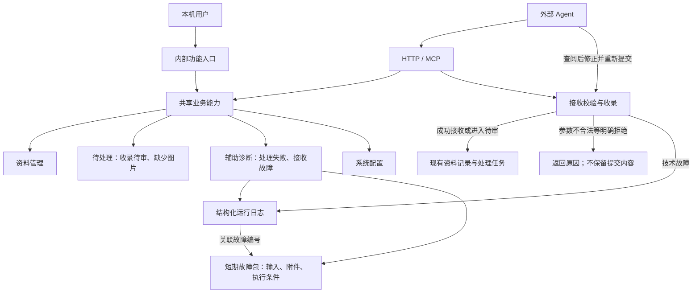

# 内部功能分类、外部 Agent 接口与接收故障诊断

Status: ready-for-agent
Type: spec
Recorded: 2026-10-18

本文整理本次讨论已确认的需求。接口现状以制定需求时的源码为依据，不代表运行中的部署。隔离分支的实现和验证见 [实施与验收记录](implementation.md)。

## Problem Statement

外部 Agent 已能收录、读取和检索资料，但缺少清晰的功能分类与接入说明。Agent 难以判断待审、缺图和处理失败分别从哪里查询、怎样修复、怎样确认结果。

“没有成功入库”还包含不同情况。已接收的资料通常有数据库记录，处理失败后仍可查询状态。接收校验未通过或收录事务回滚时，可能没有资料 ID，只留下当次错误响应。普通运行日志会截断请求正文，也不保留上传文件，其他 Agent 无法仅凭错误摘要复原现场。

用户希望保留必要的排障能力，同时避免在内部长期积累被拒绝的内容。最终方案是：明确拒绝的内容不保留正文、附件和故障包；接收过程发生技术故障时，记录运行日志，并在诊断目录短期保留故障包。

## Solution

### 目标与范围

1. 内部功能和外部接口共用“资料管理、待处理、辅助诊断、系统配置”四类名称。
2. 每类功能区分“查询”和“操作”。HTTP 与 MCP 是接入方式，共用业务定义。
3. 待处理只保留“收录待审”和“缺少图片”两类。处理失败归辅助诊断。
4. 外部 Agent 能读取待处理原因，调用已有操作，并确认结果。
5. 接收过程发生技术故障时，Agent 能通过日志找到故障包，读取原始输入和执行条件，再决定修正、重新提交或继续处理。

分类覆盖现有功能，但本次新增行为集中在待处理接入说明、接收故障日志和故障包。资料管理及系统配置复用现有能力，不因分类而扩建管理功能。

### 总体关系

图中的共享能力不要求新增统一调度层。故障包属于诊断材料，不进入文件库、检索索引或知识图谱。

### 内部功能分类

| 分类 | 包含内容 | 主要查询 | 主要操作 |
| --- | --- | --- | --- |
| 资料管理 | 收录、阅读、检索、星标、内容类型、实体、主题、关系与关注 | 资料及正文、检索结果、实体与主题信息 | 收录、修正和整理资料 |
| 待处理 | 收录待审、缺少图片 | 待处理清单、审核原因、缺失图片与补全状态 | 审核、补来源、补图、接受缺失；按现有规则确认拒绝或丢弃 |
| 辅助诊断 | 处理失败、接收故障、处理进度、模型调用、任务队列、运行日志、操作日志与检索测评 | 失败阶段、错误原因、执行记录和故障材料 | 重试或取消处理，以及现有诊断恢复操作 |
| 系统配置 | 库规则、模型、API Key、运行参数 | 当前配置与能力 | 按现有规则修改配置 |

这些名称用于页面入口、接口文档和 MCP 工具说明。保留各功能已有的上下文入口，不要求将所有页面改成四个独立顶级页面。诊断读取和恢复操作不增加待处理页面的标签及计数。

### 结果分类与留存原则

| 情况 | 归属 | 内容留存与查阅 |
| --- | --- | --- |
| 接口拒绝：参数不合法、JSON 格式错误、超过上限、认证不通过 | 返回调用方；不建立内部待办 | 不保留请求正文、附件副本或故障包。可留不含内容的最小运行事件 |
| 模型审核未通过，等待用户判断 | 收录待审 | 沿用现有待审记录及原文预览；这不是用户最终拒绝 |
| 用户明确确认拒绝或丢弃 | 结束该资料的待处理 | 删除原文与独占附件，移除关联故障包中的内容；不建立“拒绝内容库” |
| 正文已入库但缺图 | 缺少图片 | 保留资料及缺失清单，按资料 ID 补交 |
| 已接收后处理失败 | 辅助诊断 | 从现有资料、处理时间线、任务和模型调用中查阅；可用正文取决于实际留存情况 |
| 接收时发生技术故障，如数据库超时、写文件失败或程序异常 | 辅助诊断 | 保存运行事件；尽力保留可复原的短期故障包 |
| 请求未到达服务端，或进程在记录前退出 | 调用方排查 | 不承诺服务端有记录；调用方保留请求编号和原始材料 |

“拒绝不留存”指不保留可恢复被拒内容的正文、附件及诊断副本。现有最小操作审计及禁止再次收录的来源标识沿用既有规则，不扩展其内容。是否连这些最小记录也取消，不在本次已确认范围内。

## User Stories

1. As a 本机用户, I want to 按四类用途找到内部功能, so that 我能区分业务待处理与执行故障。
2. As an 外部 Agent, I want to 按相同分类发现 HTTP 和 MCP 能力, so that 我能选择已有接口而不依赖网页操作。
3. As an 外部 Agent, I want to 读取收录待审原因和原文并执行适用操作, so that 我能补来源或重新审核，并向用户报告仍需判断的事项。
4. As an 外部 Agent, I want to 读取缺图清单并按资料 ID 补交图片, so that 我能补全资料并确认是否仍有缺失。
5. As an 外部 Agent, I want to 查询已接收资料的失败阶段、原因和已有结果, so that 我能排障后使用现有接口重试。
6. As a 用户, I want to 明确拒绝的内容不再留在正文、附件或诊断材料中, so that 内部不会形成另一份拒绝资料库。
7. As an 接手排障的 Agent, I want to 凭故障编号读取日志、原始输入、关联图片和执行条件, so that 我无需依赖最初提交 Agent 的会话即可复原现场。
8. As an 外部 Agent, I want to 明确知道材料不完整、已过期或结果未知, so that 我不会盲目重放或重复创建资料。

## Implementation Decisions

### 1. 复用现有接口与共享业务规则

以下 HTTP 路径统一以 `/api/v1` 为前缀。外部工具继续使用有效 API Key；服务保持本机访问边界。所有有效 Key 仍可访问个人空间全部库，不新增按 Key 划分的业务权限体系。

#### 资料管理与系统配置

| 分类 | 查询示例 | 操作示例 | MCP 现状 |
| --- | --- | --- | --- |
| 资料管理 | `GET /libraries`、`GET /entries/:id`、`GET /entries/:id/body`、`POST /search`、`POST /graph/search` | `POST /ingest`、`PUT /entries/:id/content-type`、`PUT /entries/:id/topics` 及现有实体、关系、关注操作 | 已有 `list_libraries`、`get_entry`、`search`、`graph_search`、`ingest` 及部分整理工具 |
| 系统配置 | `GET /libraries/:id`、`GET /models`、`GET /system/settings`、`GET /space/api-keys` | 现有库、模型、系统参数和 API Key 的配置修改接口 | 不要求在本次为所有管理动作补 MCP 工具 |

实体合并建议及分类、主题修正归资料整理。它们不自动变成新的待处理标签，也不新增自动判断错误的规则。

#### 待处理

| 能力 | 现有 HTTP | 现有 MCP | 契约要求 |
| --- | --- | --- | --- |
| 读取收录待审 | `GET /entries/pending` | `list_pending` | 返回资料标识、所属库、原因及可供预览的内容入口 |
| 处理收录待审 | `POST /entries/:id/review` | `approve_pending`、`discard_pending` | 按现有来源规则和确认要求执行，不能以补证据名义绕过审核 |
| 读取缺图清单 | `GET /ingest/incomplete` | `list_incomplete` | 返回资料标识、库、缺失图片地址、原因和是否已尝试补全 |
| 上传图片 | `POST /ingest/assets` | 无上传工具；`ingest` 支持内联图片 | 保留现有附件大小及类型限制 |
| 按资料 ID 补图 | `POST /ingest` | `ingest` | 提交目标库与 `entry_id`，只补缺失图片，不改正文文字 |
| 接受缺失 | `POST /ingest/:id/accept-incomplete` | `accept_incomplete` | 是用户判断，不把“接受缺失”冒充“图片已补全” |
| 丢弃缺图资料 | `POST /ingest/:id/discard` | 无对应工具 | 沿用现有删除及确认规则 |

现有 HTTP 审核动作有 `approve`、`retry`、`supplement_url`、`admit_unverified`、`reject` 和 `discard`。现有 MCP `approve_pending` 提供 `approve`、`supplement_url`、`admit_unverified`，丢弃由 `discard_pending` 提供。文档必须标明协议差异，不暗示 MCP 已覆盖全部 HTTP 动作。

待审与缺图列表沿用现有分页规则。HTTP 已支持按库过滤；MCP 当前未提供相同的库过滤参数。HTTP 缺图列表默认包含已尝试补全的资料，可用 `include_attempted=false` 排除；MCP `list_incomplete` 固定排除已尝试补全的资料。这些现状须写入接入说明。

Agent 补图后应通过收录结果和资料状态确认结果，不能将“从 MCP 缺图列表消失”视为补全成功。沿用一次外部补全后仍缺失则交由用户处理的规则。

#### 辅助诊断的既有能力

| 能力 | 现有 HTTP | 本次要求 |
| --- | --- | --- |
| 查询处理失败资料 | `GET /entries?parse_status=failed` | 复用现有资料列表，不通过全文检索发现失败资料 |
| 查询详情、原文与时间线 | `GET /entries/:id`、`GET /entries/:id/body`、`GET /entries/:id/stages` | 分别表明状态、原因及原文是否仍可读取 |
| 重试、批量重试与取消 | `POST /entries/:id/reprocess`、`POST /entries/batch-reparse`、`POST /entries/:id/cancel-parse` | 沿用已有任务协调与检查点恢复行为 |
| 主题历史归入 | `GET /topics/:id/backfill`、`POST /topics/:id/backfill/retry` | 保持原有上下文入口 |
| 诊断执行过程 | `GET /entries/:id/model-calls`、`GET /system/runtime/queues`、`GET /system/runtime/queues/:queue/tasks` | 复用已有查询，按关联资料或任务定位 |
| 操作与维护状态 | `GET /operation-logs`、`GET /maintenance/status`、`GET /vault/status` | 说明各记录的范围；操作日志不能代替接收故障日志 |

以上能力目前主要由 HTTP 提供，MCP 尚未覆盖完整闭环。本次不要求把每个管理接口逐一变成 MCP 工具；外部 Agent 可使用已注明的 HTTP 入口。新增接收故障的查询能力同时提供 HTTP 和 MCP。

### 2. 接收故障的判定

接收诊断覆盖 HTTP 收录、MCP `ingest` 及其图片上传过程中的技术故障。已进入后台处理的资料继续使用现有资料与任务诊断；同一次故障不重复创建业务失败资料。

必须根据实际错误类型分类，不能仅依据 HTTP 状态码或现有 `status=invalid` 推断。当前部分内部收录故障也会被包装成逐项 `invalid`，新增诊断必须保留其真实的技术故障类别。

| 类别 | 例子 | 是否保留故障包 | 后续处理 |
| --- | --- | --- | --- |
| 接口明确拒绝 | JSON 错误、字段不支持、缺少必填项、超限、认证失败 | 否 | 调用方修正后重新提交 |
| 可判断的暂时故障 | 数据库连接中断、暂时写入失败、上游服务暂不可用 | 尽力保留 | 排除故障后重试，不承诺自动成功 |
| 其他技术故障 | 未预期异常、内部事务失败 | 尽力保留 | 先读取原因，不能统一视为可重试 |
| 结果未知 | 提交结果未返回，无法确认事务是否提交 | 有完整材料时保留 | 先核对是否已产生资料或任务，再决定重试 |

### 3. 运行日志

运行事件至少包含：服务端生成的故障编号、现有 `request_id`、时间、接入方式、失败阶段、错误码与原因、重试建议、提交工具标识，以及可用的库、批次条目序号、资料和任务关联。

故障编号是独立的诊断标识。没有 `entry_id` 的故障也必须能查询。来自调用方的请求编号只用于关联，不能直接作为文件路径或唯一存储标识。

每个事件记录故障包是否可用、缺失原因及过期时间。数据库完全不可用时，仍可尽力向本机运行日志和诊断目录写入；诊断接口的身份校验仍遵循现有规则，不承诺数据库故障期间一定能在线查询。

事件使用固定字段，供诊断查询解析。自由文本错误不能成为唯一索引。日志及故障包独立于业务事务，收录回滚不得撤销已经完成的诊断落盘。不得让诊断写入失败覆盖原始业务错误。

收录及诊断材料读取接口不再将完整请求、响应正文、内联图片写入共享滚动日志。相关模型调试输出同样不得绕过此规则保存被拒内容。最小运行事件可以保留操作类型和错误类别，但不能夹带原文片段。诊断内容读取本身也不能再次将内容写回访问日志。

### 4. 短期故障包

故障包复用现有本机存储能力，放在实际运行目录的诊断区域。它不写入正式文件库、不建立资料记录、不参与索引、关注动态或图谱，也不新增数据库中的业务失败表。

| 材料 | 要求 |
| --- | --- |
| 清单 | 故障编号、时间、关联请求与条目、已知执行结果、材料清单、完整性状态和过期时间 |
| 原始输入 | 失败条目的完整原始提交及 Markdown；保持原始快照，不在快照上编辑 |
| 图片 | 保留实际提交的图片字节；只有 `asset_id` 或远程 URL 不算完整图片材料 |
| 执行条件 | 程序版本、可取得的有效库策略及处理参数、相关模型标识；不包含凭据 |
| 执行过程 | 失败阶段、已完成步骤、可用的错误和相关调用结果；未取得的内容明确标为缺失 |

不得保存 Authorization、API Key、模型密钥或整份环境变量。保留原始业务输入与排除认证凭据是两个要求，不能为了去除认证头而截断正文。

#### 捕获与保留

1. 通过身份检查后，在现有请求大小上限内临时捕获必要输入。可使用有界缓冲或临时文件，不得为复原功能无限读取请求。
2. 只在实际发生技术故障时将对应材料转为短期故障包。成功请求和明确拒绝的请求清理诊断临时副本。
3. 收录回滚可能清理业务暂存材料。需要复原的输入和附件必须在失去读取能力前保留，不能事后假定还能从业务目录找回。
4. 批量请求只保留发生技术故障的条目及其必要图片，不把成功或被拒的其他条目一起打包。不能安全分离时，标明材料不完整，不以保留整批内容作为兜底。
5. 使用 `asset_id` 的图片要在故障包中保留可读取副本，避免原上传过期后无法重放。复制失败或只接收到部分上传内容时，记录缺失范围。
6. 包内容及清单完成落盘后，才报告材料完整。中途退出或写入失败不得产生“完整可复原”的假记录。

故障包的完整性至少区分“可用、部分可用、不可用、已过期”。“可用”表示本次输入和已知执行条件完整，不表示外部服务状态及模型输出可逐字重现。

#### 生命周期与拒绝清理

故障包按有限保留期和总容量上限清理。可用时间及失效原因对外可见；清理后不得把缺失材料当作系统仍可恢复。具体保留天数和容量数值见文末待定参数。

明确拒绝一份已关联故障包的资料时，要移除对应原文、独占图片及可还原内容的诊断副本。共享图片只移除该拒绝内容的诊断副本，不删除其他资料仍在使用的附件。用户实际执行拒绝、删除等不可逆动作，仍遵守既有确认要求。

故障包是临时排障材料，不作为业务备份的一部分承诺长期恢复。已被外部导出或进入既有历史备份的副本无法远程撤回。本次不执行历史日志和备份的批量清理。

### 5. 新增诊断查询契约

以下为建议名称，用于表达所需能力，尚不是现有接口。HTTP 与 MCP 共享查询服务和字段含义，MCP 失败遵循现有 `isError` 约定。

| 能力 | 建议 HTTP | 建议 MCP |
| --- | --- | --- |
| 接收故障列表 | `GET /diagnostics/ingest-failures` | `list_ingest_failures` |
| 单次故障详情与关联日志 | `GET /diagnostics/ingest-failures/:id` | `get_ingest_failure` |
| 读取故障包中的原始输入或图片 | `GET /diagnostics/ingest-failures/:id/materials/:material_id` | `read_ingest_failure_material` |

列表支持时间范围、工具标识、目标库、故障类别、请求编号和故障编号过滤，并分页返回。无库信息的接收故障仍可在未限定库时找到。列表只返回摘要和包状态，不内嵌长文或图片。

详情返回已知的执行结果、日志、材料清单、完整性、缺失原因和过期时间。读取材料只接受清单中的材料标识，不接受任意本机路径；大段文本支持分段读取，图片通过受现有认证保护的读取入口提供。读取不触发重新处理。

诊断目录里的结构化事件及包清单构成查询来源，不要求新增数据库持久化失败记录。过期或未成功落盘的材料返回明确状态；不能静默返回空正文并宣称复原成功。

查询继续按个人空间及现有认证规则执行，不把日志目录暴露成可任意浏览的文件服务。HTTP 与 MCP 返回相同的材料可用性判断。

### 6. Agent 修复流程

1. 待处理修复：查询待审或缺图清单，读取原因及资料，执行适用操作，再查询最终状态。
2. 已接收资料的处理失败：查询失败资料及时间线，排障后使用现有重新处理入口；正文不可读时明确报告，不能凭错误摘要重建正文。
3. 接收故障：按请求编号或故障编号查询日志及故障包，读取材料，先核对已存在的资料或任务，再修正或重新提交。
4. 没有资料 ID 或明确已经回滚的新收录，使用通用 `ingest` 重新提交。已有资料则按当前状态选择补图、重新审核或重新处理，不能统一重新建一份资料。
5. 为修复接收故障提交的条目可携带可选的来源故障编号，用于将新请求及结果关联到旧故障。该字段只用于诊断，不参与正文、来源身份和去重指纹。字段名称在契约定稿时确定。
6. 原始快照保持不变，修正后的请求作为新请求提交。新的 `accepted` 仅表示已接收；只有继续确认处理结果后才能报告修复完成。进入待审或仍缺图时应如实报告。

不新增自动重放入口。读取故障包不获得执行授权；审批判断和不可逆操作继续受现有确认约束。外部 Agent 负责选择并调用已有业务操作。

## Testing Decisions

### 验证边界

以现有 HTTP/MCP 的外部契约为主要验收边界：从提交请求，到查询诊断材料，再通过已有入口重新提交。事务回滚和文件留存必须使用已有 PostgreSQL、磁盘或对应测试夹具证明，不以单纯模拟日志函数代替。

分类与文档组织通过检查导航、说明及工具描述验收，不为分类建立新的测试体系。优先复用现有收录、HTTP/MCP 契约、日志、附件与事务测试。只有现有覆盖不足时，新增一个复原主路径和一个关键失败路径；沿用现有测试框架。

### 验收标准

| 编号 | 场景 | 可观察结果 |
| --- | --- | --- |
| AC-01 | 查看内部功能与接入说明 | 四类名称一致；待处理只有收录待审、缺图；处理失败可从辅助诊断进入 |
| AC-02 | 外部 Agent 处理待审或缺图 | 能查询原因和材料，使用已有接口操作，并区分已接收、待审、仍缺图与处理完成 |
| AC-03 | 接口参数或格式被拒绝 | 返回明确原因；不生成资料、故障包或保留正文片段的运行日志 |
| AC-04 | 模型审核未通过后由用户拒绝 | 拒绝前仍可预览待审原文；最终拒绝后不能从新增诊断能力取回该内容，不误删共享附件 |
| AC-05 | 在有效图文提交中注入技术故障并使业务回滚 | 即使没有资料 ID，仍能凭请求或故障编号读取日志、完整输入、图片及已知执行条件 |
| AC-06 | 从故障包修复并重新提交 | 沿用现有审核与去重规则；关联旧故障和新结果；不会因读取或重放建议自动创建重复资料 |
| AC-07 | 批次中同时存在成功、拒绝和技术故障条目 | 故障包仅包含技术故障条目的必要内容，其他条目的结果不受影响 |
| AC-08 | 故障包写入失败、附件缺失或保留期到期 | 两种协议均返回真实完整性和原因；原始业务错误不被覆盖，不宣称可完整复原 |
| AC-09 | 请求包含认证信息，或读取诊断材料 | 包和日志不包含认证凭据；诊断读取不把原文重新写入共享访问日志 |
| AC-10 | 查询已有处理失败资料 | 可以获取失败阶段与原因；原文不可用时明确说明，不依赖检索索引命中 |

以上为需求验收条件，不等于要求新增十组测试。新增复原主路径重点覆盖 AC-05、AC-06；关键失败路径重点覆盖 AC-03、AC-08、AC-09 中本次改动触及的留存与降级行为，其余优先复用既有测试及定向断言。

## Out of Scope

- 不引入采集、远程图片下载、文件格式转换或站内 Agent。
- 不建立永久提交档案、拒绝资料库、通用工作流或第二套任务队列。
- 不新增来源未核实、缺发布时间、分类待复核等业务待办类别。
- 不要求所有现有 HTTP 管理操作都提供 MCP 工具，不新增按 Key 分库或分工具权限。
- 不重新设计资料状态、审核标准、去重、正文定稿、图谱正本或现有确认规则。
- 不将故障包并入正式文件库、检索索引或业务备份，不承诺精确复现外部服务及模型输出。
- 不执行历史数据清理、部署、提交代码或实际拒绝操作；这些不是生成本需求文档的附带动作。

## Further Notes

### 与已有决策的关系

本文沿用单用户、本机访问、外部工具负责获取原文、只接收 Markdown 与图片的边界。待审保留和最终拒绝清理沿用当前领域定义；故障包只补技术故障的短期诊断能力。

分类用于组织现有功能，不要求改变现有 URL。现有资料记录、任务记录与操作日志继续各自承担原有职责；日志与故障包不替代它们。

### 已定稿的参数

- 故障包保留 7 天，总容量上限 512 MiB。先清理过期包，再按创建时间淘汰最旧的包；该配置由用户于 2026-10-18 确认。
- 新增 HTTP 路径采用 `/api/v1/diagnostics/ingest-failures` 及详情、材料子路径；MCP 工具采用 `list_ingest_failures`、`get_ingest_failure`、`read_ingest_failure_material`。修复关联字段为 `recovery_failure_id`。

若用户要求连最小拒绝审计和防重标识也不保留，需要另行说明对现有拒绝规则的改变。

### 现状依据与资料入口

- [领域上下文](../../CONTEXT.md)及 [ADR 0014](../../docs/adr/0014-internal-knowledge-base.md)：库、资料、待审、缺图、处理与拒绝规则。
- [ADR 0012](../../docs/adr/0012-ingest-only-no-collection.md)与 [ADR 0015](../../docs/adr/0015-no-login-local-only.md)：采集职责与本机接入边界；较早术语和补全定位以当前 ADR 0014 为准。
- [资料 HTTP 路由](../../internal/router/routes_entry.go)、[实体路由](../../internal/router/routes_entity.go)、[主题路由](../../internal/router/routes_topic.go)及 [MCP 注册](../../internal/mcpserver/server.go)：现有接口与协议差异。
- [待处理页面](../../frontend/src/views/library/components/PendingReviews.vue)：当前收录待审、缺图两个标签。
- [收录服务](../../internal/application/service/ingest.go)与 [事务边界](../../internal/application/service/task_transaction.go)：接收失败、逐项结果及回滚行为。
- [正文读取](../../internal/application/service/entry.go)与 [收录失败处理](../../internal/application/service/entry_intake.go)：已接收记录的查阅，以及部分失败路径的原文清理。
- [请求日志](../../internal/middleware/logger.go)、[模型调试日志](../../internal/logger/llm_logger.go)及 [日志说明](../../docs/logging.md)：当前正文截断、调试内容与日志保留机制。
- [外部工具接入](../../docs/external-integration.md)及 [收录 API](../../docs/ingest-api.md)：现有认证、补图和异步状态语义。

## Comments

2026-10-18：根据本次讨论形成完整需求。仅新增本文，未修改代码、领域文档或部署。最初讨论过的“永久提交失败记录”和“所有提交先留存原文”方案均已被当前“拒绝不留内容、技术故障短期保留故障包”方案替代。
