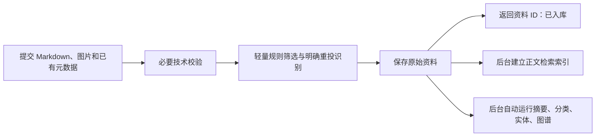

# 库模板入库、审核与处理规则（worktree 已实现，未部署）

日期：2026-10-22。分支：`codex/library-redesign`。已合并用户确认的六项决定，第 3 项精确判重建议也已获确认。本版规则已在该 worktree 实现。仅修改源码、相关测试和文档；未部署，未修改运行数据，未修改资料自检 skill。

**默认接收；保留依据；后台检查会影响使用的问题；人工只处理需要判断的重要冲突。**

## 共用链路

所有库模板统一使用本规则，基于模板创建的库沿用本规则。这里不预设具体库的分类或用途。

技术校验通过且未命中明确排除规则时，保存资料。正常保存不等待模型审核或后台处理。摘要、分类、实体和图谱默认全部自动运行，失败只影响对应任务，不阻塞保存和正文检索。精确判重与覆盖规则见下文，已获用户确认。

同来源或同链接的新正文直接覆盖旧文；这取代此前“不覆盖旧文”的方向。必须先完成该条内容和全部已提交图片的技术校验，再提交覆盖；任一图片不合格时整条报错，不修改已有资料。部署前仅在隔离测试数据库验证覆盖，不对运行数据执行覆盖。

**已入库**表示正文、已有元数据及本次确认接收的图片已可靠保存；**可检索**表示相应检索索引已就绪。两者分别说明，不能因模型任务未完成否认已经保存，也不能在索引失败时声称已经可检索。

## 保留的要求

| 环节 | 保留什么 |
| --- | --- |
| 身份与目标库 | 校验 API Key、所属空间和目标库存在，防止写错位置或引用无权使用的附件。 |
| 输入与资源上限 | 正文须可读且非空，纯链接、仅图片仍不接收；不新增最小篇幅要求。校验请求格式、字段合法性、长度及资源预算。先沿用现有技术上限，例如每批 50 条、单条正文连同串文和引用合计 500 万 Unicode 码点。 |
| 外部输入轻筛 | 只用明确规则筛掉无关内容、广告和能确认的重复投递；拿不准时接收，不把含商业链接一概视为广告。内部内容直接接收；二者按输入来源区分，所有模板共用判断。 |
| 图片 | 图片可不提交；已提交的图片检查真实格式、大小、可读性、附件引用和解码预算。任一图片不合格时该条整体报技术错误，不部分保存或覆盖；批量请求仍逐项返回结果。现有支持格式先沿用，不要求下载未提供的远程图片，不生成缺图待办。 |
| 正文与来源 | 保存本次提交的 Markdown、图片及已有元数据；已定位到同来源旧文时直接覆盖，不另存新正文记录，不建设版本系统。程序不自行补全文或润色原稿。标题缺失不阻止保存，后台可补标题；来源、作者、发布时间等未知就留空。收录时间不冒充发布时间，保留已有的来源未核实、模型生成等标记。 |
| 获取方式 | `acquisition` 可选；提供时仍校验 `verbatim`、`extracted` 或 `model_written`，缺失保留未知，不替用户补填任何已有枚举值。 |
| 现有存储 | 正文保存在数据库，图片保存在附件目录，`.md` 按需导出；不进行存储迁移。 |
| 写入与重试 | 写入失败明确报告技术错误，不声称保存成功，不变成内容待审。同次投递的确定重试避免重复保存；已有人工拒收记录不由模型自动撤销。 |
| 正文检索索引 | 用正文建立基础检索索引，不依赖摘要、分类或图谱。全文索引失败时保留已保存资料、说明暂不可检索并允许重试；向量不可用时优先使用已有全文检索，后台补算向量。 |
| 后台处理质量 | 摘要、分类、实体和图谱默认全部运行，只发布有依据且通过自身校验的结果。没有可抽取实体或关系时允许空结果，不为“都运行”凑造事实。失败只影响该项结果和重试，不阻止原文入库或正文检索。 |

技术上限依据：[收录参数](../../internal/types/ingest.go)、[接口校验](../../internal/application/service/ingest.go)。字段可缺省不等于允许伪造或非法值；提供时仍校验其合法格式。

## 取消的要求或入库门槛

| 旧要求 | 本版调整 |
| --- | --- |
| 逐条模型价值审核与常规人工待审 | 取消；正常内容经轻量校验后保存，不逐条排队等人工判断。 |
| 来源必须有链接、文献标识或机构加日期 | 取消来源齐全的准入门槛；缺失不阻挡保存，提供时保留依据和已有标记。 |
| 来源字段按模板拒收 | 取消 `source_ref` 仅限自有型、`identifier` 仅限外部长效型这类差异；合法的已有标识统一接收。定位同来源和识别重投按下文精确判重与覆盖规则执行。 |
| 固定结构、篇幅、章节、完整度或文笔 | 取消；接受草稿、片段和摘要，不要求模型先把内容补成完整文章。 |
| 入口近似查重、转载自动归并 | 取消入口语义与近似归并；语义重复留给独立自检发现，不自动合并、挂链接或删除。明确重试的幂等保留。 |
| 摘要、分类、实体和图谱必须成功 | 取消作为保存、入库成功或正文可检索的前提。它们保存后默认后台运行；摘要固定 3–5 条等输出要求不能挡住入库，也不能为凑条数编造内容。 |
| 长文必须先完成分段审核、模型汇总或图谱核查 | 取消作为入库前提；模型上下文、分段上限或输出格式问题只影响对应后台任务，不转成人工内容待审。原始请求本身超出技术资源上限仍明确报错。 |

取消的是这些门槛，不是删除摘要或图谱能力。后台任务仍应校验自身结果，失败记录技术原因；不把不合格派生数据当成事实写入。正文覆盖后，正文索引及摘要、分类、实体和图谱均按新内容更新，不将旧正文的派生结果当作新正文的结果使用；后台失败不回滚已成功保存的新正文。

## 精确判重与覆盖

只用同库内可靠的来源标识（例如 `source_ref`、`identifier` 或规范化 URL）和精确内容比较，不调用模型做入口近似判重。

| 情况 | 处理规则 |
| --- | --- |
| 同库、同来源唯一定位到旧记录，保存内容完全一致 | 返回已有资料 ID，不重复建条，也不重复运行后台处理。比较应涵盖正文、实际提交的图片和已提供元数据，不能仅因正文相同而丢掉新增图片或来源信息。 |
| 同来源唯一定位到旧记录，保存内容有变化 | 直接覆盖旧文，保留资料 ID，更新正文索引并重新运行后台处理。 |
| 缺少可靠来源标识 | 正常新建，不仅凭正文相同自动合并；疑似重复留给独立自检报告。 |
| 来源标识匹配有歧义 | 不猜测覆盖目标，明确报告定位问题；不转成模型价值审核或常规人工待审。 |

不同库独立处理，不跨库合并或覆盖。上述规则已确认；外部输入的具体排除规则尚未定义，未明确的规则不启用，拿不准时接收，不预建规则引擎。

## 与资料自检分开

资料自检单独见[调研记录](../../docs/research/library-content-check-scope.md)与 [skill 草案](skills/reliquary-content-check/SKILL.md)。这里只规定日常入库链路，不展开自检步骤或调度，不把检查报告变成逐条待审任务。人工只判断同一适用条件下互不相容、可能影响实际回答的重要冲突；不同时间、版本或范围的说法可以同时保留。

## 验收边界

- 正常投递不会因缺少 `acquisition`、来源、摘要、分类或图谱而进入待审；后台模型暂不可用时仍能保存正常资料并建立正文检索索引，记录后台任务失败并允许重试。
- 已保存资料可读取；索引未就绪时如实说明。全文索引可用时，摘要、分类、图谱或向量暂时失败不妨碍正文检索。
- 内容未超技术资源上限时，不因后台模型的上下文或分段上限拒收；纯链接、仅图片和真正的输入、存储或权限故障仍明确报错，不伪装成功。
- 同来源新正文直接覆盖旧文，并刷新相关派生数据；校验失败时旧文不变。任一已提交图片不合格时整条失败，不部分保存。
- 摘要、分类、实体和图谱默认全部运行，允许有据可查的空抽取结果；同来源保存内容完全相同时返回原 ID，无可靠来源标识时不凭正文相同自动合并。

[旧策略对照](library-strategy-review-v1.md)仅作旧实现的事实定位。[ADR 0014](../../docs/adr/0014-internal-knowledge-base.md) 已追加本轮修订，CONTEXT.md 与收录 API 文档同步更新。运行中的程序尚未更新。

## 首轮实施验证（2026-10-22）

- 入库只做技术校验；来源与 acquisition 可选；同来源未变返回原 ID，有变化覆盖；无来源标识时新建。所有模板共用保存和后台处理。
- 正文索引先建立，模型失败保留正文及已建全文索引。队列以正文索引及模型处理分别判断完成；旧任务快照不能覆盖更新后的正文。生成型也支持重新处理。
- 已提交图片在保存前实际解码，失败整条回滚；原始字节归档到附件目录后移除临时上传副本。精确来源查询复用既有索引，不扫描全文或调用模型。
- 旧策略测试已同步：取消逐条价值审核、按模板强制来源、正文相似归并、生成型只建索引、分类控制默认图谱等断言。改为验证默认接收、可靠来源定位、同 ID 覆盖、统一后台处理和按需导出 Markdown；保留坏图、权限、写入及审计回滚校验。
- 本轮修复四处相关问题：文档任务不能因正文索引完成而漏掉模型重试；处理失败后重试须复用已完成的分段；模型重试耗尽不能把已可检索的正文标成解析失败；丢失批量子任务后，资料不能永久停留在处理中。分类纠正保留图谱关系，审计失败仍回滚。
- 最终后端完整命令为 `go test -p 1 -count=1 -json ./...`，启用独立 PostgreSQL/Redis 测试环境，没有过滤或跳过失败用例。共执行 2547 个用例（含子用例）：2513 通过、13 失败、21 跳过。按顶层用例统计为 1421 通过、10 失败、17 跳过；13 个失败中包含同一个鉴权测试的 3 个失败子用例。应用服务、HTTP/MCP 中本次相关用例及队列测试均通过。
- 前端完整命令为 `TSX_TSCONFIG_PATH=tsconfig.app.json npm test`：921 个用例，884 通过、30 失败、7 跳过。在未修改的 main 上使用相同命令复核，数量及 30 个失败用例名称完全一致。本轮没有修改前端源码或依赖。
- 完整测试集仍未通过。下表的 10 个后端顶层失败均在未修改的 main（`a32521b9`）上复现；没有修改这些既有失败的业务行为，也没有删掉测试来隐藏失败。

| 范围 | 顶层失败数 | 已核实的既有失败 |
| --- | ---: | --- |
| 迁移与副本 | 4 | `TestLibraryIntakeMigrationPreservesHistoricalRows`、`TestIKB09ReplicaUpgradeImportAndTamperDetection`、`TestIngestContractMigrationUpDownUpAndPreservation` 的表清单缺少 `entry_batch_items`；`TestLibraryUpgradePreservationProjection` 的旧库投影及文件清单不一致。 |
| HTTP 鉴权 | 2 | `TestIngestHTTPBatchDoesNotHideItemCredentialFailures` 的凭据读取次数；`TestIngestHTTPAssetAndCompletionCredentialFailures` 的附件接口 `Retry-After`。 |
| 网络调用守卫 | 1 | `TestProductionOutboundCallsMatchReviewedAllowlist` 将资料诊断的本地 `Get` 调用误列为外呼，且 reranker 函数改名后清单未同步。 |
| 历史迁移断言 | 1 | `TestLibraryReviewRoutingMigrationPreservesCustomPoliciesAndModels` 将固定版本迁移 SQL 与后续改过的审核常量比较。 |
| 前端静态守卫 | 2 | `TestEntryNamingGuard` 的旧命名例外清单；`TestMarkdownOnlyCapabilityGuard` 将普通保存结果“不确定”文案判作已移除能力。 |

- 后端 21 项跳过中，16 项需要独立 Neo4j 测试环境，4 项需要外部模型 API 凭据；另 1 项是仅由子进程调用的队列夹具。未使用部署 Neo4j 或真实模型凭据补跑这些实测。
- 完整后端日志：`/tmp/reliquary-library-full-confirmed.jsonl`；前端与 main 对照日志：`/tmp/reliquary-library-frontend-configured.log`、`/tmp/reliquary-library-frontend-main-baseline.log`。main 后端对照分别保存在 `/tmp/reliquary-library-baseline-auth.log`、`/tmp/reliquary-library-baseline-maintenance.jsonl`、`/tmp/reliquary-library-baseline-guards.jsonl`、`/tmp/reliquary-library-baseline-networkguard.jsonl`。
- `git diff --check` 与改动 Go 文件的格式检查通过。当前实现累计涉及 65 个源码、测试与领域/API 文档文件，另更新本规则与地图；新增依赖 0，未新增数据库迁移。增加的文件主要是用户本轮要求同步的旧策略测试。资料自检 skill 未改，未部署，未修改运行数据，改动保留在 `codex/library-redesign` worktree。

## 剩余失败定位与修复（2026-10-22）

用户要求继续定位前述 10 个后端和 30 个前端失败。已区分程序缺陷、测试装置问题与过时断言；未通过删除失败用例或关闭检查处理。

| 原失败 | 根因与处理 |
| --- | --- |
| 3 项旧副本校验提示 `entry_batch_items` 多余 | 维护代码漏了版本 28 新建空表的校验转换。只为跨越该版本的旧副本补入预期空表；非空记录、现版本缺表及原始证据仍严格检查。新增一项小回归验证这些限制。 |
| 1 项旧库升级校验失败 | 版本 9→10 转换误用当前模板默认值，导致历史配置随现行规则变化。恢复转换改用与固定版本 000010 SQL 一致的历史值，不改变新建库规则。 |
| 1 项历史审核迁移断言 | 000030 SQL 是固定历史版本，却与后来变化的审核常量比较。测试改为验证该版本实际约定的历史文字。 |
| 2 项 HTTP 鉴权断言 | 测试改为验证一次请求共享认证、下次请求重新认证，且失效凭据不能新增资料。上传故障测试改用有效 PNG，避免被 `.txt` 格式拒绝提前截断。未修改认证实现。 |
| 3 项后端静态守卫 | 仅补充已核对的本地诊断读取、既有 i18n 键和保存状态文案例外；同步 reranker 已有函数名称。仍检测新增外呼、未声明旧命名及已移除能力。 |
| 29 项前端测试失败 | 补齐图片作用域模拟和实体图谱组件 stub，更新 API 导入、当前库分类、来源标签、导航、历史日志和网格布局断言。3 项详情缺失随模拟修复消失，没有修改页面布局或产品文案。 |
| 1 项输入法清理测试失败 | Node 的 EventTarget 对布尔捕获选项的移除行为与浏览器不同。三处移除监听使用标准 `{ capture: true }`，保留原卸载断言。真实 Chrome 对照确认旧版、新版在浏览器中均正常。 |

- 原后端失败及相关检查的定向测试已通过；原 5 项迁移失败单独重跑全部通过。
- 前端最终完整命令（在 `frontend/`）：`BROWSER_TESTS=1 TSX_TSCONFIG_PATH=tsconfig.app.json node --import /tmp/reliquary-browser-chrome.mjs --import tsx --test`，921 通过、0 失败、0 跳过。日志为 `/tmp/reliquary-frontend-all-browser.log`。临时 Chrome 启动适配仅选择已有 Chrome 可执行文件与无头模式，使用独立临时浏览器上下文，未修改日常配置、未安装依赖。常规完整日志与浏览器单跑日志另存于 `/tmp/reliquary-frontend-final.log` 和 `/tmp/reliquary-browser-seven.log`。
- 最终完整后端命令：`go test -p 1 -count=1 -json ./...`，退出码 0；2548 个测试及子测试中 2527 通过、0 失败、21 跳过，41 个有测试的包全部通过。日志为 `/tmp/reliquary-library-clean-full.jsonl`。其中 16 项需要未配置的独立 Neo4j 测试环境，4 项需要外部模型 API 凭据，另 1 项是只在子进程运行的队列夹具。没有过滤已知失败或连接运行数据库。
- 额外验证：迁移与恢复完整包 150 项、数据库迁移工具包 24 项全部通过，无跳过（`/tmp/reliquary-migration-fixes-package.jsonl`）；鉴权与静态守卫定向 26 项通过（`/tmp/reliquary-followup-auth-guards-after.jsonl`）。上述用例已包含在最终完整后端执行中。
- 最终 `git diff --check` 和改动 Go 文件格式检查通过。原 40 项失败均已定位处理；主分支源码未改，改动保留在 `codex/library-redesign` worktree，未提交。
- 本轮只修改必要恢复代码、测试和事件监听清理参数；不修改资料自检 skill，不部署，不修改运行数据库，不增加依赖或数据库迁移。

## 真实集成补跑（2026-10-22）

本轮只补跑上次因配置缺失而跳过的 20 项真实集成测试；此前完整测试结果保留，不把本轮定向执行表述为又跑了一轮全量测试。

| 范围 | 本轮结果 |
| --- | --- |
| Neo4j 真实集成 | 16 通过、0 失败、0 跳过；包括恢复后重建、实体投影、图谱一致性、Redis 清空恢复、Neo4j 停机恢复、积压同步和 HTTP/MCP 图谱检索。 |
| 真实外部聊天模型 | 4 个子用例仍因缺少指定凭据跳过，外部调用未执行，不能算通过。 |

- 先只读检查现有服务和模型配置。运行中的 Neo4j 不用于测试；创建任务独占的 `reliquary-test-neo4j`，使用已有 `neo4j:5.26.12-community` 镜像，固定地址 `bolt://127.0.0.1:57687`，搭配原有独立 PostgreSQL/Redis 测试实例。未启停正式服务或改写正式数据。
- 首次创建测试实例时误用了动态端口，重启后端口变化，造成恢复测试及后续连接失败。已改为文档要求的固定端口；原动态端口测试容器停止后保留，未删除。
- 固定端口后定位出一处测试等待问题：Neo4j 在 21:21:55.602 才开放 Bolt 连接，而原 30 秒同步等待在 21:21:56 已截止。只在 `internal/graphreplica/integration_test.go` 增加两行，先以既有 60 秒上限等待真实连接可用，再保留原 30 秒同步断言、两库一致性检查和失败任务最终完成检查。未改业务恢复逻辑。
- 停机恢复单项复测通过；随后使用 `-p 1 -count=1 -json` 对上述 16 项完整复跑，四个包全部通过。单项日志：`/tmp/reliquary-neo4j-recovery-ready.jsonl`；最终 16 项日志：`/tmp/reliquary-real-neo4j-final.jsonl`。测试结束后固定端口实例恢复运行并保留。

旧模型测试的硬编码依赖如下，仅说明原跳过原因，不是当前项目的模型配置要求：

| 子用例 | 测试预设模型 | 旧测试期待的配置 |
| --- | --- | --- |
| `DeepSeek_API` | DeepSeek 官方 `deepseek-chat` | `DEEPSEEK_API_KEY` |
| `Aliyun_DeepSeek` | DashScope `deepseek-v3.1` | `ALIYUN_API_KEY`，并具备此聊天模型的调用权限 |
| `Aliyun_Qwen3-32b` | DashScope `qwen3-32b` | 同上，对应模型调用权限 |
| `Aliyun_Qwen-max` | DashScope `qwen-max` | 同上，对应模型调用权限 |

- 当前可见环境及配置未提供这两项凭据。现有应用配置是代理 Gemini 聊天，以及阿里云私有 MaaS 地址上的向量化和重排；不能据此认定它们可调用上述官方聊天接口。未解密、复制或展示已有密钥，也未替换测试目标。
- 已执行 `go test -count=1 -json ./internal/models/chat -run '^TestRemoteAPIChat$'` 核对跳过原因，日志为 `/tmp/reliquary-real-model-config-check.jsonl`。父测试通过不代表四项真实调用通过。这四个供应商组合不是用户提出的需求；不能要求用户为了旧测试额外配置 DeepSeek 或 DashScope 聊天凭据。当前环境的实际模型验证见下文。
- 原先第 21 项 `TestQueueCrashChild` 是由父测试启动的子进程夹具，不属于这 20 项真实集成测试，也不需要外部配置。
- 本轮仅改上述一个现有测试文件及本规则、地图两份记录，新增依赖和迁移均为 0。仍在 `codex/library-redesign` worktree；资料自检未改，未部署，未提交。

## 按当前模型配置复核（2026-10-22）

用户指出 DeepSeek 不是其要求后，按现有配置完成真实验证，不用旧测试指定的供应商反推产品需求。

- 只读复核：当前有 5 个启用模型。远程聊天为 `gemini-3.8-flash`；空间选中的向量模型为 `qwen3-vl-embedding`，1024 维；远程重排为 `qwen3-vl-rerank`。三项均已保存可解密凭据，无需补配密钥。另两个本地模型没有被空间选中，本轮不验证。当前无资料库，无法核对库级聊天、重排绑定。
- 上轮 16 项真实 Neo4j 集成测试已全部通过；本轮复核日志及独立实例状态，没有在未改相关代码时重复执行。正式 Neo4j 未启停。
- 使用忽略目录中的临时程序，按工作树的 `ConfigFromModel` 和现有客户端工厂构造三类客户端。配置仅从正式库只读加载；凭据只在进程内解密。未传入调用记账配置，不写正式模型调用记录，不走正式业务接口，不使用文章正文或图片。
- 首次从宿主机默认代理环境调用，向量化和重排返回 EOF，聊天超时。无凭据 HEAD 对照确认服务可达；只清除临时测试进程的代理变量后，同一配置、同一客户端、同类输入的三项调用全部通过。未修改系统代理、应用环境、模型地址或密钥。

| 实际模型 | 验证内容 | 结果 |
| --- | --- | --- |
| `gemini-3.8-flash` | 合成短文本、非流式聊天；回复非空且 token 用量有效 | 通过，约 8.4 秒 |
| `qwen3-vl-embedding` | 合成短文本向量化；1024 维、数值有限且非全零 | 通过，约 6.3 秒 |
| `qwen3-vl-rerank` | 两段合成短文本重排；两条结果、索引合法且唯一、分数有限 | 通过，约 6.3 秒 |

- 汇总日志：`/tmp/reliquary-current-models-final.json`；三项原始结果为 `/tmp/reliquary-current-chat-direct.json`、`/tmp/reliquary-current-embedding-direct.json`、`/tmp/reliquary-current-rerank-direct.json`。首次代理环境失败记录为 `/tmp/reliquary-current-model-results.json`。
- 统计必须分开：原 20 项中的 16 项 Neo4j 已通过，4 项旧指定供应商用例仍未执行；另完成当前三个实际模型的基础调用验证。不能把这三项替换成“旧四项已通过”，也不能声称原 20 项全通过。本轮未验证流式、图片能力或回答与排序质量。
- 本轮未修改业务代码或原模型测试，没有新增依赖、迁移、模型绑定或供应商要求。只更新本记录与地图；临时程序在已忽略的 `.cache/library-model-probe/`。仍在 `codex/library-redesign` worktree；资料自检未改，未部署，未提交。
