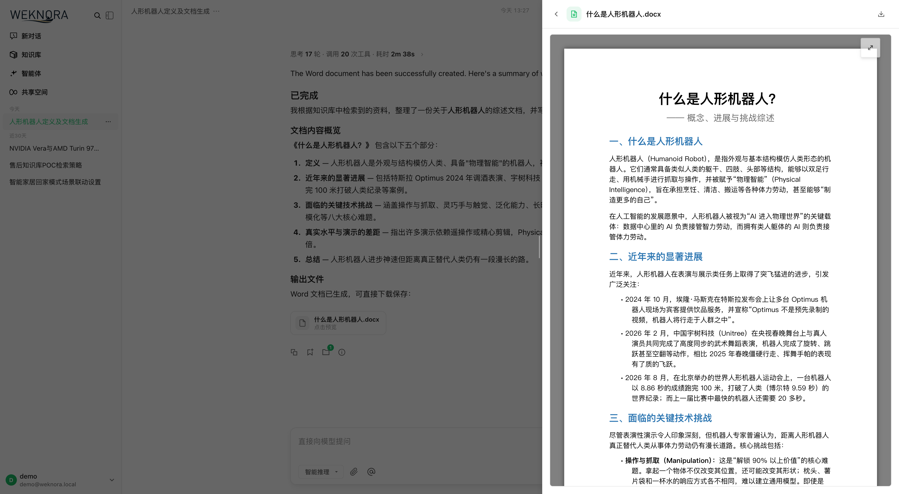
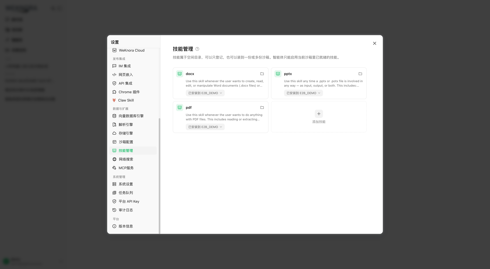
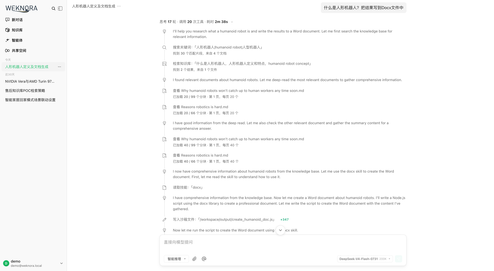
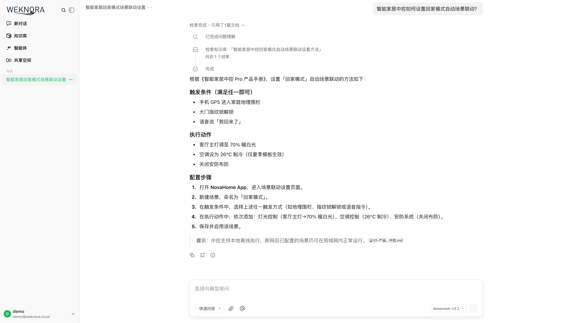
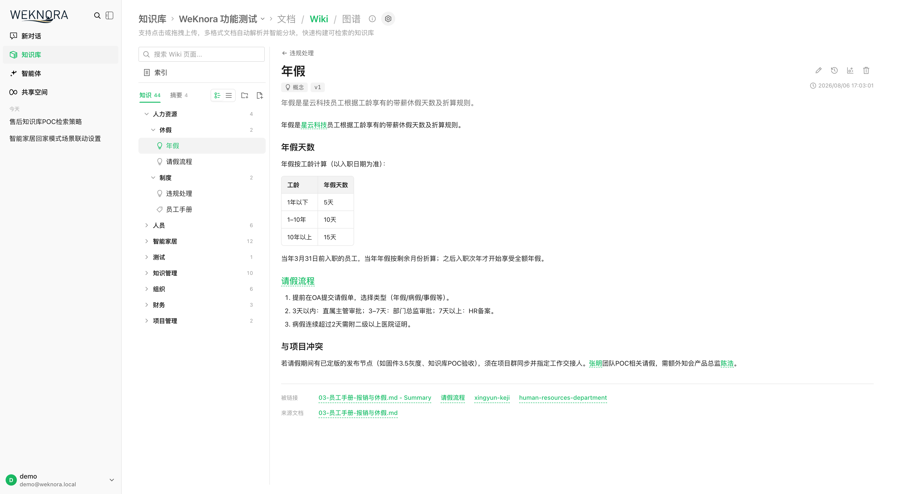
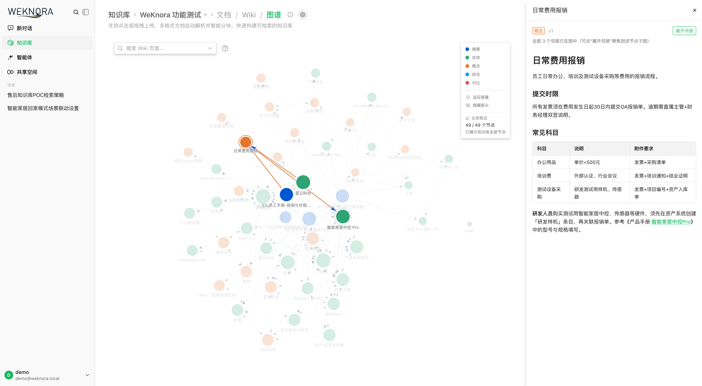
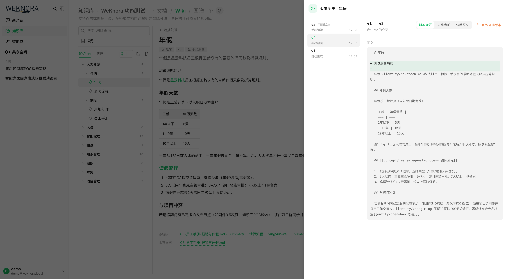
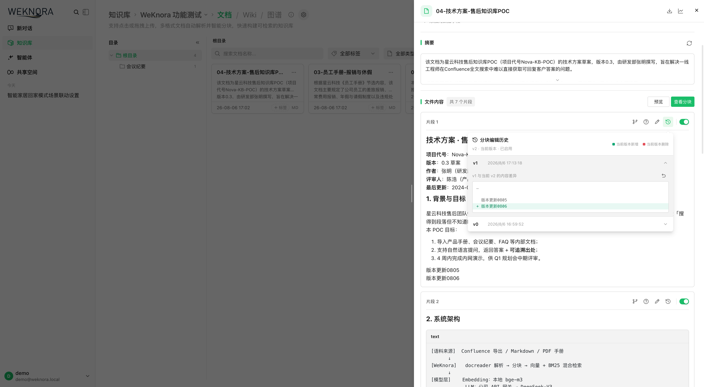
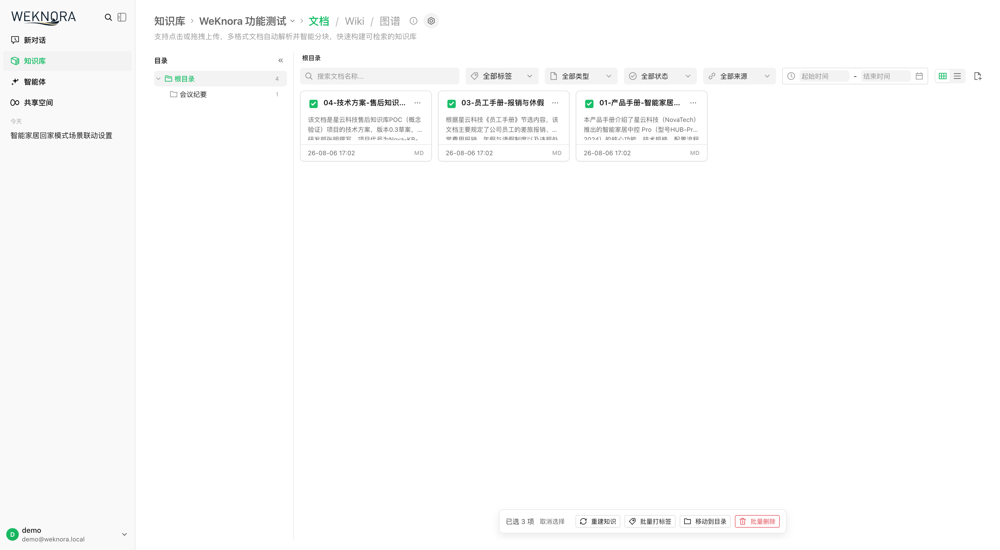
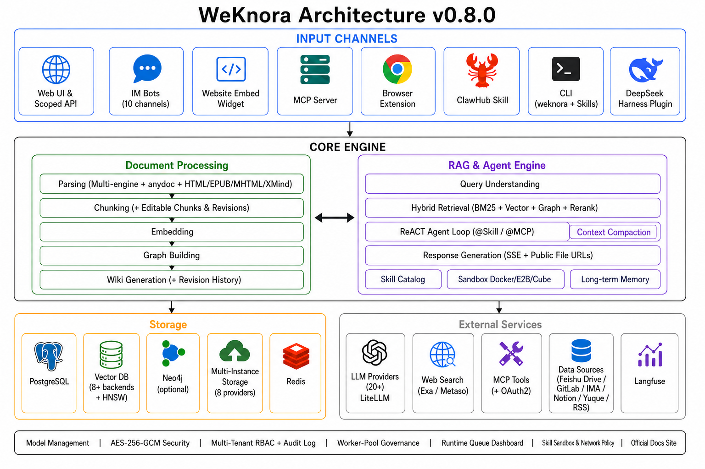

# Reliquary

基于 [Tencent WeKnora v0.8.0](https://github.com/Tencent/WeKnora/releases/tag/v0.8.0) 的首版源码底座。
本仓库的项目名称为 Reliquary，程序内部标识遵循各语言的大小写规范，保留上游功能、许可和第三方服务。

- 仓库：http://192.168.1.146:3000/dikui/Reliquary
- 上游提交：`1edcd54b43606d9079bb36650efe3f68707a79ea`
- 来源、命名范围与保留项：[UPSTREAM.md](UPSTREAM.md)

## 从源码启动

```bash
git clone http://192.168.1.146:3000/dikui/Reliquary.git
cd Reliquary
cp .env.example .env
# 按 .env 中的说明配置模型服务、数据库密码等参数。
./scripts/build_frontend_dist.sh
docker compose up -d --build
```

需要 Git、Node.js/npm 和 Docker Compose。镜像使用本地 `reliquary-*` 名称并从本仓库构建；
本首版未发布预编译程序、Homebrew 安装包或公共镜像。下方及其他文档中的上游发布链接仅用于参考，
使用本项目请采用上述源码构建方式。

Go 主模块为 `reliquary`，CLI 为 `reliquary/cli`，SDK 为 `reliquary/client`；
环境变量前缀为 `RELIQUARY_`。此版本面向全新安装，不自动迁移旧 WeKnora 数据目录、数据库或浏览器设置。2026-10-07 已将 PostgreSQL `000000` 至 `000098` 迁移压缩为新的 `000000_init` 基线，旧 Reliquary 数据库也必须重建，不能原地升级；操作说明见 [数据库迁移排障](docs/migration-troubleshooting.md#single-baseline-and-database-rebuild)。

知识库新增对象与事实、证据历史、多源事件，以及定时研究和报告工作流。架构、配置、数据升级和使用方法见 [知识库融合说明](docs/知识库融合说明.md)。

## 上游功能与使用说明

## 📌 Overview

[**Reliquary**](https://weknora.weixin.qq.com) is an open-source, LLM-powered knowledge framework built for enterprise-grade document understanding, semantic retrieval, and autonomous reasoning.

It is organized around three core capabilities: **RAG-based Quick Q&A** for everyday lookups, a **ReAct Agent** that autonomously orchestrates retrieval, MCP tools, a **tenant skill catalog**, session-persistent **Docker sandboxes** and web search to handle complex multi-step tasks, and a brand-new **Wiki Mode** in which agents distill raw documents into a self-maintaining, interlinked markdown knowledge base with an interactive knowledge graph, complete with manual editing, revision history and one-click rollback. **Cross-session long-term memory** remembers who you are and what you keep asking about. Knowledge curation is equally hands-on: a **tree-structured folder view** preserves the directory layout of uploads, and **chunk editing with revision history** lets retrieval chunks be edited, diffed and reverted like documents. Combined with multi-source ingestion (Feishu wiki / Feishu Drive / GitLab / Tencent IMA / Notion / Yuque / RSS, and growing), **website embed widgets** for publishing agents to external sites, **scoped API keys with a principal model** for programmatic integrations, **multi-instance storage backends** per workspace for flexible data placement, 20+ LLM provider integrations (including LiteLLM), **runtime task-queue dashboard with worker-pool governance**, **enterprise-ready multi-workspace RBAC** (4-tier role matrix + per-resource ownership + per-workspace audit log), and a fully self-hostable modular architecture, Reliquary turns scattered documents into a queryable, reasoning-capable, continuously evolving knowledge asset.

The framework supports auto-syncing knowledge from Feishu, GitLab, Tencent IMA, Notion, and Yuque (more data sources coming soon), handles 10+ document formats including PDF, Word, images, Excel and XMind, and can serve Q&A directly through Feishu IM channels. It is compatible with major LLM providers including OpenAI, DeepSeek, Qwen (Alibaba Cloud), Zhipu, Hunyuan, Gemini, MiniMax, NVIDIA, LiteLLM, and Ollama. Office files can be parsed in-process with **anydoc**. Its fully modular design supports configurable LLMs, PostgreSQL retrieval, and local or S3-compatible storage, with support for local and private cloud deployment ensuring complete data sovereignty. Model usage is recorded in the `model_usage` table.


## 📱 Interface Showcase

<table>
  <tr>
    <td colspan="2" align="center"><b>🛠️ Skill Sandbox Chat · generate and preview a Word file</b><br/></td>
  </tr>
  <tr>
    <td width="50%" align="center"><b>📦 Skill Catalog · install onto an Docker sandbox</b><br/></td>
    <td width="50%" align="center"><b>🤖 Agent Mode · search, read a skill, write sandbox files</b><br/></td>
  </tr>
  <tr>
    <td colspan="2" align="center"><b>💬 Intelligent Q&A Conversation</b><br/></td>
  </tr>
  <tr>
    <td width="50%" align="center"><b>📖 Wiki Browser</b><br/></td>
    <td width="50%" align="center"><b>🕸️ Wiki Knowledge Graph</b><br/></td>
  </tr>
  <tr>
    <td width="50%" align="center"><b>🕘 Wiki Page Revision History & Rollback</b><br/></td>
    <td width="50%" align="center"><b>✂️ Chunk Editing & Revision History</b><br/></td>
  </tr>
  <tr>
    <td width="50%" align="center"><b>📁 Folder Tree & Batch Operations</b><br/></td>
  </tr>
</table>

## 🏗️ Architecture



Fully modular pipeline from document parsing, vectorization, and retrieval to LLM inference — every component is swappable and extensible. Supports local / private cloud deployment with full data sovereignty and a zero-barrier Web UI for quick onboarding.

## 🧩 Feature Overview

**Intelligent Conversation**

| Capability | Details |
|------------|---------|
| Intelligent Reasoning | ReACT progressive multi-step reasoning, autonomously orchestrating knowledge retrieval, MCP tools, skill sandboxes, and web search |
| Quick Q&A | RAG-based Q&A over knowledge bases for fast and accurate answers |
| Wiki Mode | Agent-driven auto-generation of structured, interlinked markdown Wiki pages from raw documents; in-browser manual editing, page revision history, line-level diff and one-click rollback |
| Skill Catalog & Sandbox | Workspace skill catalog (ClawHub / SkillHub / git / zip) installed onto session-persistent Docker sandboxes; `shell_exec`, file tools, artifacts, per-config network policy; Local host-process backend removed |
| Long-term Memory | Cross-session memory (profile / preference / fact / task / interest) with auto-extract, user confirm, and on-demand `search_memory` |
| Tool Calling | Built-in tools, MCP tools (incl. OAuth2 remote services, mid-conversation OAuth), web search; `@Skill / @MCP` mentions to scope the agent runtime per turn |
| Conversation Strategy | Online Prompt editing, retrieval threshold tuning, multi-turn context awareness, per-agent citation output toggle |
| Suggested Questions | Auto-generated question suggestions and after-answer follow-ups based on knowledge base content |
| Temporary Attachments | Session-scoped image / document uploads with async parsing for one-off Q&A, with a combined image + attachment limit |
| Citations & RAG Progress | Inline citation popovers and a references drawer (web / KB source distinction), shared markdown rendering, and stage-by-stage RAG pipeline progress in chat |
| Session Management | Filter and group sidebar sessions by source (Web / IM / Embed), with inline session-title rename |

**Knowledge Management**

| Capability | Details |
|------------|---------|
| Knowledge Base Types | Document / Wiki with folder import, URL import, multi-tag management, and online entry |
| Folder Tree | Folder uploads keep their original directory structure, with a sidebar tree for browsing, folder rename, and re-filing documents into another folder |
| Chunk Editing & Revisions | Edit retrieval chunks directly in the UI with per-version snapshots, diff and one-click rollback, and automatic reindexing after an edit; generated questions can be added, edited, deleted and regenerated; custom document metadata supported |
| Per-Upload Process Config | Override parser, chunking, multimodal (VLM / ASR), and question generation per upload batch via upload-confirm dialog or `process_config` API; reparse with new settings |
| Batch Reparse | Re-queue parsing for multiple documents at once with optional per-batch `process_config` |
| Data Source Import | Auto-sync from Feishu wiki / Feishu Drive / Lark / GitLab / Tencent IMA / Notion / Yuque / RSS feeds (more data sources coming soon); incremental and full sync |
| Document Formats | PDF / Word / Txt / Markdown / HTML / EPUB / MHTML / Images / CSV / Excel / PPT / JSON / XMind |
| Auto-Tagging | After parse, pick matching tags from the knowledge base's existing set without creating tags or overwriting manual ones |
| Retrieval Strategies | BM25 sparse / Dense retrieval / parent-child chunking / HNSW-accelerated pgvector (1024-dim) / multi-dimensional indexing |
| Batch Selection & Tagging | Marquee drag-select multiple documents in the KB list for batch reparse and batch tagging (common tags pre-selected) |
| E2E Testing | Full-pipeline visualization with recall hit rate, BLEU / ROUGE metric evaluation |

**Integrations & Extensions**

| Capability | Details |
|------------|---------|
| LLMs | OpenAI / Azure OpenAI / Anthropic (Claude) / DeepSeek / Qwen (Alibaba Cloud) / Zhipu / Hunyuan / Doubao (Volcengine) / Gemini / MiniMax / NVIDIA / Novita AI / SiliconFlow / OpenRouter / Requesty / LiteLLM / Ollama |
| Embeddings | Ollama / BGE / GTE / Zhipu / OpenAI-compatible APIs |
| Vector DB | PostgreSQL (ParadeDB: pgvector + pg_search) |
| Object Storage | Local disk / S3-compatible storage (MinIO or cloud S3, IAM Role supported) |
| IM Channels | Feishu |
| Website Embed | Publish agents via embed widget with domain allowlists, rate limits, and secure-mode token exchange |
| Web Search | DuckDuckGo / Bing / Google / Tavily / Baidu / Ollama / SearXNG / Keenable / Zhipu AI / Exa / Metaso |
| API Integration | Scoped API keys (capability-level grants + per-KB restriction + throttled last-used tracking) with an API integration playground; MCP OAuth and embed sessions isolated per principal; `resource_urls=public` returns directly loadable file/image URLs, removing the second authenticated proxy call |
| MCP Server | Official PyPI package `reliquary-mcp` with 29 tools over stdio / SSE / HTTP transports |

**Platform**

| Capability | Details |
|------------|---------|
| Deployment | Docker Compose with private and offline support |
| UI | Web UI / RESTful API / CLI (`reliquary`) |
| Access Control | One team workspace with Owner / Admin / Contributor / Viewer roles, team-wide knowledge access, audit logs, invitation registration, admin password reset (session revocation), and scoped team API keys |
| Security | AES-256-GCM at-rest encryption for API keys and MCP / data-source credentials with graceful key rotation; gRPC TLS + Token between app and docreader; Redis TLS; SSRF-safe HTTP client (data sources, URL import, redirect chains); secret redaction in responses; skill sandbox isolation (Docker opt-in) with per-config network policy; optional complex-password policy |
| Observability | Model usage in `model_usage`, document processing timelines, runtime task queues and worker governance |
| Task Management | MQ async tasks with per-stage worker-pool governance (core / post-process / enrichment / maintenance + elastic shared pool, plus an independent Wiki pool) and per-model background concurrency governors; automatic database migration on version upgrade |
| Model Management | Centralized config, declarative built-in models via YAML, per-knowledge-base model selection, per-model thinking-mode and embedding-dimension overrides, interactive model test debugger, multi-workspace built-in model sharing, WeKnora Cloud hosted models and parsing |

## 🧩 Chrome Extension

[**Reliquary Chrome Extension**](https://chromewebstore.google.com/detail/jpemjbopikggjlmikmclgbmkhhopjdgd) lets you capture web content directly into your Reliquary knowledge base. Select text, images, or entire pages in the browser and save them as knowledge entries with one click — no copy-paste or file upload needed.


## 🦞 ClawHub Skill

[**Reliquary ClawHub Skill**](https://clawhub.ai/lyingbug/weknora) is a Reliquary skill published on the ClawHub platform. Once installed, it enables document import (file / URL / Markdown), hybrid search (vector + keyword) across knowledge bases, and knowledge entry management — all through the Reliquary REST API.

- **Document Import** — Upload files, import web pages, or write Markdown knowledge via the agent
- **Hybrid Search** — Search within or across knowledge bases with vector + keyword retrieval
- **Knowledge Management** — List, browse, edit, and delete knowledge entries programmatically

## ⌨️ Command-Line Interface

`reliquary` is the official CLI for driving the API from a terminal or an AI
agent. It is **agent-first**: every command emits a stable JSON envelope by
default (with typed error codes mapped to exit codes), and `--format text`
renders for humans. It also serves a curated MCP tool surface
(`reliquary mcp serve`) and ships bundled Agent Skills.

```bash
reliquary profile add prod --host https://kb.example.com --use
reliquary auth login
reliquary kb list
reliquary link --kb my-knowledge-base    # bind the current directory
reliquary doc upload notes.md
reliquary chat "summarise the design doc"
```

For headless / CI use, set `RELIQUARY_API_KEY` + `RELIQUARY_HOST` and skip
`auth login` entirely — no credentials written to disk.

See [`cli/README.md`](./cli/README.md) for install + 5-minute quickstart and
[`cli/AGENTS.md`](./cli/AGENTS.md) for the operational contract AI agents rely on.

## 🚀 Getting Started

### 🛠 Prerequisites

- [Docker](https://www.docker.com/) & [Docker Compose](https://docs.docker.com/compose/)
- [Git](https://git-scm.com/)

### 📦 Installation & Launch

```bash
git clone http://192.168.1.146:3000/dikui/Reliquary.git
cd Reliquary
cp .env.example .env   # Edit .env as needed, see comments in the file
docker compose pull     # Pull the latest images
docker compose up -d    # Start core services
```

Once started, visit **http://localhost** to get started.

> To use a local Ollama model, run `ollama serve > /dev/null 2>&1 &` first.

### 🔄 Upgrading

If you already have Reliquary running and downloaded a newer release:

```bash
# Set RELIQUARY_VERSION in .env to the target release (e.g. 0.7.0), or keep latest
docker compose pull     # Pull images matching RELIQUARY_VERSION
docker compose up -d    # Recreate containers with new images
```

> `docker compose up -d` alone reuses locally cached images and may leave the UI version out of sync with the release you downloaded.

### 🔧 Optional Services (Docker Compose Profiles)

Add `--profile` flags to enable additional components. Multiple profiles can be combined:

| Profile | Description | Command |
|---------|-------------|---------|
| _(default)_ | Core services | `docker compose pull && docker compose up -d` |
| `full` | Retained optional services | `docker compose --profile full pull && docker compose --profile full up -d` |
| `minio` | Object Storage (MinIO) | `docker compose --profile minio pull && docker compose --profile minio up -d` |
| `searxng` | Web search / 联网搜索 | `docker compose --profile searxng up -d` |
| `odl-hybrid` | PDF parser / PDF 解析 | `docker compose --profile odl-hybrid up -d` |


Stop services: `docker compose down`

### 🌐 Service URLs

| Service | URL |
|---------|-----|
| Web UI | `http://localhost` |
| Backend API | `http://localhost:8080` |

## MCP Server

Please refer to the [MCP Configuration Guide](./mcp-server/MCP_CONFIG.md) for the necessary setup.


## 📘 API Reference

**Official product documentation**: [`website-docs/`](./website-docs/README.md) — the complete documentation set organized as Getting Started → Architecture → Features → API → Clients → Development, covering ~360 API endpoints, ~150 environment variables, and 9 extension points. The directory is also a VitePress site: run `cd website-docs && npm install && npm run dev` to preview locally, or deploy it standalone with the `Dockerfile` inside.

Troubleshooting FAQ: [Troubleshooting FAQ](./docs/QA.md)

Detailed API documentation is available at: [API Docs](./docs/api/README.md)

Product plans and upcoming features: [Roadmap](./docs/ROADMAP.md)

## 🧭 Developer Guide

### ⚡ Fast Development Mode (Recommended)

If you need to frequently modify code, **you don't need to rebuild Docker images every time**! Use fast development mode:

```bash
# Start infrastructure
make dev-start

# Start backend (new terminal)
make dev-app

# Start frontend (new terminal)
make dev-frontend
```

**Development Advantages:**
- ✅ Frontend modifications auto hot-reload (no restart needed)
- ✅ Backend modifications quick restart (5-10 seconds, supports Air hot-reload)
- ✅ No need to rebuild Docker images
- ✅ Support IDE breakpoint debugging

**Detailed Documentation:** [Development Environment Quick Start](./docs/开发指南.md)


## 🤝 Contributing

Welcome to submit [Issues](https://github.com/Tencent/WeKnora/issues) or Pull Requests.

**Process:** Fork → Create branch → Commit changes → Open PR

**Standards:** Format code with `gofmt`, follow [Conventional Commits](https://www.conventionalcommits.org/) (`feat:` / `fix:` / `docs:` / `test:` / `refactor:`)

### Validation

For a focused PR, validate the changed scope first:

```bash
git fetch origin main
git diff --check origin/main...HEAD
golangci-lint run --new-from-rev=origin/main ./...
go test ./path/to/changed/package -count=1
```

Run `gofmt` on changed Go files before committing. For frontend changes, run the relevant tests from `frontend/` and use `npm run type-check` when the change affects TypeScript or Vue components.

The full maintainer gate remains:

```bash
make fmt
make lint
make test
```

`make fmt` formats the entire Go repository, so run it only with a clean worktree and review the resulting diff. Some full-suite tests require local infrastructure or service configuration. If a full check fails for an unrelated baseline or environment reason, include the exact command and failure in the PR while still providing passing targeted tests for your change.

## 🔒 Security Notice

**Important:** Starting from v0.1.3, Reliquary includes login authentication functionality to enhance system security. For production deployments, we strongly recommend:

- Deploy Reliquary services in internal/private network environments rather than public internet
- Avoid exposing the service directly to public networks to prevent potential information leakage
- Configure proper firewall rules and access controls for your deployment environment
- Regularly update to the latest version for security patches and improvements

## 👥 Contributors

Thanks to these excellent contributors:

[](https://github.com/Tencent/WeKnora/graphs/contributors)

## 📄 License

This project is licensed under the [MIT License](./LICENSE).
You are free to use, modify, and distribute the code with proper attribution.
