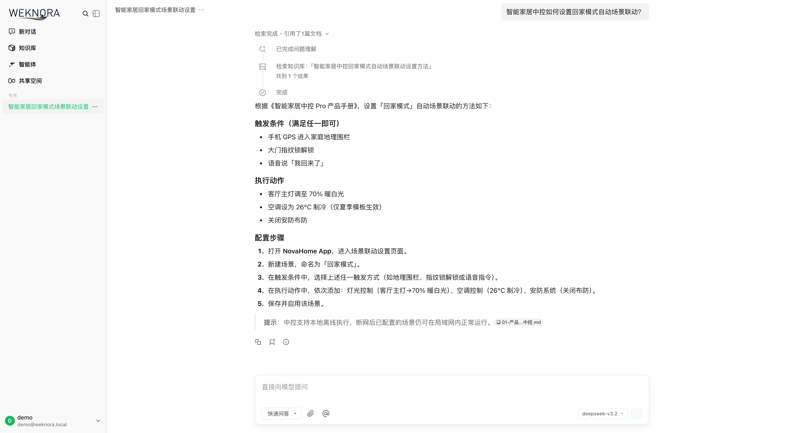
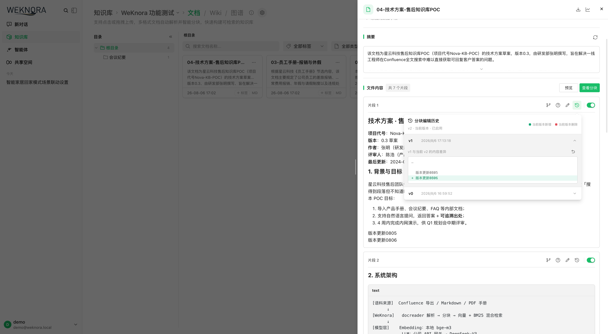
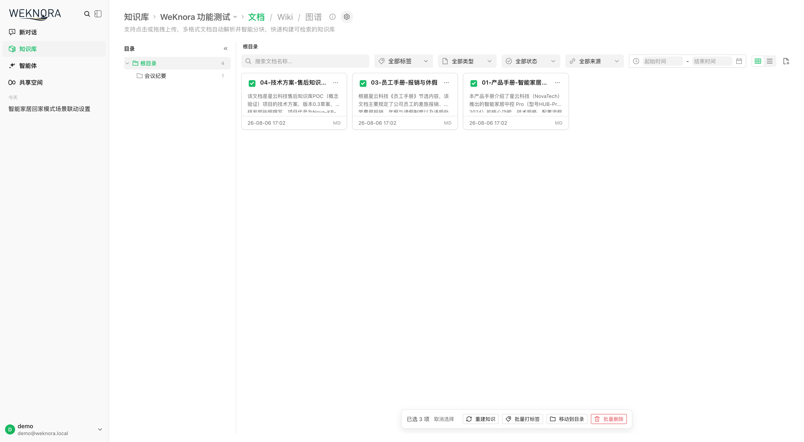
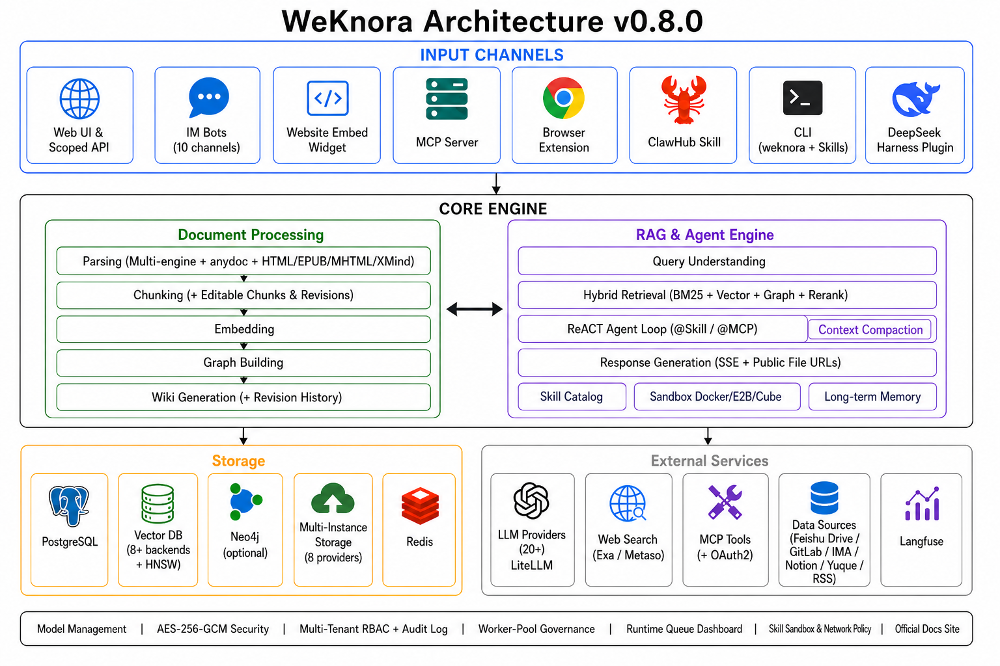

<p align="center">
  <picture>
    
  </picture>
</p>

<p align="center">
  <picture>
  </picture>
</p>
<p align="center">
    <a href="https://weknora.weixin.qq.com" target="_blank">
        
    </a>
    <a href="https://chatbot.weixin.qq.com" target="_blank">
        
    </a>
    <a href="https://chromewebstore.google.com/detail/jpemjbopikggjlmikmclgbmkhhopjdgd" target="_blank">
        
    </a>
    <a href="https://github.com/Tencent/WeKnora/blob/main/LICENSE">
        
    </a>
    <a href="./CHANGELOG.md">
        
    </a>
</p>

<p align="center">
| <a href="./README.md"><b>English</b></a> | <b>简体中文</b> | <a href="./README_JA.md"><b>日本語</b></a> | <a href="./README_KO.md"><b>한국어</b></a> |
</p>

<p align="center">
  <h4 align="center">

  [项目介绍](#-项目介绍) • [架构设计](#-架构设计) • [核心特性](#-核心特性) • [快速开始](#-快速开始) • [文档](#-文档) • [开发指南](#-开发指南)

  </h4>
</p>

# 💡 Reliquary：个人知识库、RAG 问答与 Agent 推理

## 📌 项目介绍

**[Reliquary（维娜拉）](https://weknora.weixin.qq.com)** 是一款开源的、基于大语言模型（LLM）的知识管理框架，专为企业级文档理解、语义检索与智能推理场景打造。

框架提供 **RAG 快速问答**、编排知识检索与 MCP 工具的 **ReAct Agent 智能推理**、进程内数据分析以及定时知识报告。树形文件夹、分块编辑与版本历史、RSS 订阅、站点适配器、完整访问 API Key 和模型集成共同支持个人知识管理。数据统一保存在 PostgreSQL 与本地磁盘。

框架支持从 RSS 订阅和站点适配器自动同步知识，覆盖 PDF、Word、图片、Excel、EPUB 等十余种文档格式。模型层面兼容 OpenAI、DeepSeek、Qwen（阿里云）、智谱、混元、Gemini、MiniMax、NVIDIA、LiteLLM、Ollama 等主流厂商。Office 文档可由 **anydoc** 在 Go 进程内解析。全流程模块化设计，大模型可灵活配置，检索统一使用 PostgreSQL，存储支持本地磁盘，支持本地与私有云部署，数据完全自主可控。模型用量继续记录在 `model_usage` 表中。

## 📱 功能展示

<table>
      <tr>
    <td colspan="2" align="center"><b>💬 智能问答对话</b><br/></td>
  </tr>
    <tr>
    <td width="50%" align="center"><b>✂️ 分块编辑与版本历史</b><br/></td>
  </tr>
  <tr>
    <td width="50%" align="center"><b>📁 文件夹树与批量操作</b><br/></td>
  </tr>
</table>

## 🏗️ 架构设计



从文档解析、向量化、检索到大模型推理，全流程模块化解耦，组件可灵活替换与扩展。支持本地 / 私有云部署，数据完全自主可控，零门槛 Web UI 快速上手。

## 🧩 功能概览

**智能对话**

| 能力 | 详情 |
|------|------|
| 智能推理 | ReACT 渐进式多步推理，自主编排知识检索、MCP 工具与数据分析 |
| 快速问答 | 基于知识库的 RAG 问答，快速准确地回答问题 |
| 工具调用 | 内置工具、MCP 工具（含 OAuth2 远程服务、会话内 OAuth 授权）；支持 `@MCP` 提及以按轮次范围化 Agent 运行时 |
| 对话策略 | 在线 Prompt 编辑、检索阈值调节、多轮上下文感知、按 Agent 引用输出开关 |
| 推荐问题 | 基于知识库内容自动生成推荐问题与答后追问 |
| 临时附件 | 会话级临时上传图片 / 文档，异步解析后用于一次性问答，支持图片与附件合并限额 |
| 引用与 RAG 进度 | 对话内引用浮层与引用抽屉、统一 Markdown 渲染、RAG 流水线分阶段进度展示 |
| 会话管理 | 查看历史会话与消息，支持会话标题内联重命名 |

**知识管理**

| 能力 | 详情 |
|------|------|
| 知识库类型 | 文档，支持文件夹导入、URL 导入、多标签管理、在线录入 |
| 文件夹树 | 文件夹上传保留原始目录结构，侧栏树形浏览、重命名文件夹、把文档重新归档到其他文件夹 |
| 分块编辑与版本历史 | 在界面直接编辑检索分块，保留逐版本快照，支持 diff 与一键回滚，编辑后自动重建索引；生成问题可增删改与重新生成；支持文档自定义元数据 |
| 按批次解析配置 | 上传确认对话框或 `process_config` API 覆盖解析引擎、分块、多模态（VLM / ASR）、问题生成；支持 reparse 时调整配置 |
| 批量重新解析 | 一次为多篇文档重新排队解析，可携带批次级 `process_config` |
| 数据源导入 | RSS、Atom、JSON Feed 和站点适配器，支持增量与全量同步 |
| 文档格式 | PDF / Word / Txt / Markdown / EPUB / 图片 / 音频 / CSV / Excel / PPT / JSON |
| 自动打标签 | 解析完成后从知识库已有标签中选择匹配项增量关联，不创建新标签、不覆盖人工标签 |
| 检索策略 | BM25 稀疏召回 / Dense 稠密召回 知识上下文增强 / 父子分块 / pgvector HNSW 加速（1024 维）/ 多维度索引 |
| 批量选择与打标签 | 知识库文档列表支持框选（marquee）多选，可批量重新解析、批量打标签（自动预选公共标签） |

**集成与扩展**

| 能力 | 详情 |
|------|------|
| 模型厂商 | OpenAI / Azure OpenAI / Anthropic（Claude）/ DeepSeek / Qwen（阿里云）/ 智谱 / 混元 / 豆包（火山引擎）/ Gemini / MiniMax / NVIDIA / Novita AI / SiliconFlow / OpenRouter / Requesty / LiteLLM / Ollama |
| 向量数据库 | PostgreSQL（ParadeDB：pgvector + pg_search）|
| Embedding | Ollama / BGE / GTE / 智谱 / OpenAI 兼容接口 |
| 对象存储 | 本地文件系统|
| 网站嵌入 | 通过嵌入 Widget 发布智能体，支持域名白名单、限流与安全模式 Token 交换 |
| API 集成 | 完整访问 API Key 与 API 集成调试台；`resource_urls=public` 直接返回可加载的文件与图片直链 |


**平台能力**

| 能力 | 详情 |
|------|------|
| 部署 | Docker Compose，支持私有化离线部署 |
| 界面 | Web UI / RESTful API |
| 权限控制 | 唯一用户拥有全部权限，首次注册后关闭注册，API Key 完整访问，本地命令重置密码 |
| 安全 | API Key 与 MCP / 数据源凭据 AES-256-GCM 静态加密、支持平滑密钥轮换；Redis TLS；防 SSRF HTTP 客户端（覆盖数据源、URL 导入、重定向链等）；密钥响应脱敏 |
| 可观测性 | `model_usage` 模型用量、文档处理时间线、运行时任务队列与 Worker 池治理 |
| 任务管理 | MQ 异步任务，分阶段独立 Worker 池治理（core / 后处理 / enrichment / maintenance + 弹性共享池）与按模型后台并发治理；版本升级自动数据库迁移 |
| 模型管理 | 集中配置，YAML 声明式内置模型配置，知识库级别模型选择，按模型思考模式与 Embedding 维度覆盖，交互式模型调试器，团队内置模型，WeKnora Cloud 托管模型与文档解析 |

## 🧩 Chrome 插件

[**Reliquary Chrome 插件**](https://chromewebstore.google.com/detail/jpemjbopikggjlmikmclgbmkhhopjdgd)支持在浏览器中直接将网页内容采集到 Reliquary 知识库。选中文本、图片或整个页面，一键保存为知识条目，无需复制粘贴或手动上传文件。


## 🚀 快速开始

### 🛠 环境要求

- [Docker](https://www.docker.com/) & [Docker Compose](https://docs.docker.com/compose/)
- [Git](https://git-scm.com/)

### 📦 安装与启动

```bash
git clone http://192.168.1.146:3000/dikui/reliquary.git
cd Reliquary
cp .env.example .env   # 按需编辑 .env，详见文件内注释
docker compose pull     # 拉取最新镜像
docker compose up -d    # 启动核心服务
```

启动成功后访问 **http://localhost** 即可使用。

> 如需使用本地 Ollama 模型，请先运行 `ollama serve > /dev/null 2>&1 &`

### 🔄 版本升级

若已有部署并下载了更新的 release：

```bash
# 在 .env 中将 RELIQUARY_VERSION 设为目标版本（如 0.7.0），或保持 latest
docker compose pull     # 拉取与 RELIQUARY_VERSION 匹配的镜像
docker compose up -d    # 用新镜像重建容器
```

> 仅执行 `docker compose up -d` 会复用本地缓存镜像，可能导致 Web UI 显示版本与下载的 release 不一致。

### 🔧 可选服务（Docker Compose Profile）

按需添加 `--profile` 启动额外组件，多个 profile 可叠加使用：

| Profile | 说明 | 启动命令 |
|---------|------|----------|
| _(默认)_ | 核心服务 | `docker compose pull && docker compose up -d` |
| `full` | 所有保留的可选服务 | `docker compose --profile full pull && docker compose --profile full up -d` |


停止服务：`docker compose down`

### 🌐 服务地址

| 服务 | 地址 |
|------|------|
| Web UI | `http://localhost` |
| 后端 API | `http://localhost:8080` |


## 🔌 使用微信对话开放平台

Reliquary 作为[微信对话开放平台](https://chatbot.weixin.qq.com)的核心技术框架，提供更简便的使用方式：

- **零代码部署**：只需上传知识，即可在微信生态中快速部署智能问答服务，实现"即问即答"的体验
- **高效问题管理**：支持高频问题的独立分类管理，提供丰富的数据工具，确保回答精准可靠且易于维护
- **微信生态覆盖**：通过微信对话开放平台，Reliquary 的智能问答能力可无缝集成到公众号、小程序等微信场景中，提升用户交互体验


## 📘 文档

使用说明见[个人使用指南](./docs/personal-use.md)、[API 文档](./docs/api/README.md)与[知识工作流说明](./docs/知识库融合说明.md)。

常见问题排查：[常见问题排查](./docs/QA.md)

详细接口说明请参考：[API 文档](./docs/api/README.md)

产品规划与计划：[路线图 (Roadmap)](./docs/ROADMAP.md)

## 🧭 开发指南

### ⚡ 快速开发模式（推荐）

如果你需要频繁修改代码，**不需要每次重新构建 Docker 镜像**！使用快速开发模式：

```bash
# 启动基础设施
make dev-start

# 启动后端（新终端）
make dev-app

# 启动前端（新终端）
make dev-frontend
```

**开发优势：**

- ✅ 前端修改自动热重载（无需重启）
- ✅ 后端修改快速重启（5-10秒，支持 Air 热重载）
- ✅ 无需重新构建 Docker 镜像
- ✅ 支持 IDE 断点调试

**详细文档：** [开发环境快速入门](./docs/开发指南.md)


## 🤝 贡献指南

欢迎通过 [Issue](https://github.com/Tencent/WeKnora/issues) 反馈问题或提交 Pull Request。

**流程：** Fork → 新建分支 → 提交更改 → 创建 PR

**规范：** 使用 `gofmt` 格式化代码，遵循 [Conventional Commits](https://www.conventionalcommits.org/) 提交（`feat:` / `fix:` / `docs:` / `test:` / `refactor:`）

### 验证方式

对于范围集中的 PR，优先验证本次改动涉及的文件和包：

```bash
git fetch origin main
git diff --check origin/main...HEAD
golangci-lint run --new-from-rev=origin/main ./...
go test ./path/to/changed/package -count=1
```

提交前请对改动过的 Go 文件运行 `gofmt`。对于前端改动，请在 `frontend/` 目录运行相关测试；如果改动涉及 TypeScript 或 Vue 组件，还应运行 `npm run type-check`。

维护者使用的全仓验证命令仍然是：

```bash
make fmt
make lint
make test
```

`make fmt` 会格式化整个 Go 仓库，因此请仅在工作区干净时运行，并检查产生的 diff。部分全量测试依赖本地基础设施或服务配置。如果全仓检查因无关的基线问题或环境依赖失败，请在 PR 中写明具体命令和错误，同时提供本次改动范围内通过的定向测试。

## 🔒 安全声明

**重要提示：** 从 v0.1.3 版本开始，Reliquary 提供了登录鉴权功能，以增强系统安全性。在生产环境部署时，我们强烈建议：

- 将 Reliquary 服务部署在内网/私有网络环境中，而非公网环境
- 避免将服务直接暴露在公网上，以防止重要信息泄露风险
- 为部署环境配置适当的防火墙规则和访问控制
- 定期更新到最新版本以获取安全补丁和改进

## 👥 贡献者

感谢以下优秀的贡献者们：

[](https://github.com/Tencent/WeKnora/graphs/contributors)

## 📄 许可证

本项目基于 [MIT](./LICENSE) 协议发布。
你可以自由使用、修改和分发本项目代码，但需保留原始版权声明。
