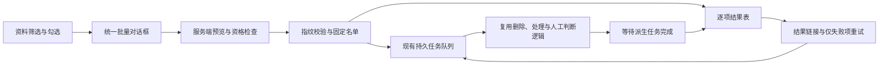

# 资料批量管理

批量对象是资料。按实体或主题筛选，得到的是直接关联资料，不会扩大到关系图中的相邻实体，也不会删除实体档案或主题定义。

## 筛选维度 × 操作支持表

批量操作支持删除、重新处理、星标、内容类型和主题修改。选择已勾选资料、指定库或全部筛选匹配资料后，服务器逐项检查资格。实体和主题筛选支持多选；不同维度取交集，同一维度取并集。

内容类型修改限同一个库，目标类型必须启用；AI产出的人工分类和主题修改继续遵守现有资格限制。所有库均支持重新处理，包括 AI产出。实体档案、关系和主题定义本身不属于资料批量操作对象。整库与批量重新审核入口已移除；历史待审资料仍可逐条人工收录或拒绝。

## 整体调整



列表查询和批量选取共用筛选条件。确认时在事务内检查范围与资格，写入固定名单并创建队列任务。执行沿用现有对象协调、库级冲突检查及业务处理函数。结果区分已排队、执行中、成功、失败、跳过和清理警告，避免把排队当作完成。

资料列表只保留统一批量入口。先选择已勾选资料或当前筛选的全部匹配资料，再进入操作选择与预览确认。原有单资料操作、实体档案维护和主题定义维护保持原入口。

## 页面操作

在资料列表筛选库、实体、主题、内容类型、处理状态、图片完整性、星标、渠道、标题关键词、更新时间或发布时间。条件不同维度取交集；同一实体或主题维度多选取并集。发布时间不使用入库时间补值，没有发布时间的资料不匹配日期范围。

进入批量管理后，第 1 步选择已勾选资料或当前筛选的全部匹配资料，第 2 步选择操作。可返回第 1 步修改范围；返回后需重新预览与确认。全部匹配包含未加载的分页，不使用检索 Top-K 或相似报道折叠作为完整名单。预览显示匹配、可执行、跳过、阻塞数量及样本；确认时再次检查预览指纹。名单或资格变化时需要重新预览，确认提交后新入库资料不加入本批次。

支持删除、按当前库配置重新处理、设置或取消星标、修改内容类型、添加或移除指定主题。主题操作保留其他主题关联；显式添加的主题记为人工判断。移除只修改当前关联，不产生永久排除规则。

内容类型修改只允许一个库，目标类型必须在该库启用。主题必须适用于资料所属库。AI产出也执行索引及后台模型处理。处理中资料不能同时重新处理或修改分类、主题；删除和星标保留原有处理规则。

资料列表不再单列全库重新审核、重建失败资料和全量重建。处理指定库的全部资料时，仅筛选该库，选择全部匹配，再选择重新处理；只处理失败资料时叠加失败状态筛选。其他筛选始终保留，不会被操作入口静默清空。待审页只保留历史资料的逐条人工处理。

批量重新处理使用当前库配置，保留正文、图片及已有人工判断；现有失败任务的断点重试仍使用原任务机制。图片未提供不改变资料的处理资格。

## 结果与重试

提交成功只表示已排队。批次等待派生任务结束后才计入成功。结果分页显示逐项状态，批次链接为 `/platform/entries?batch_id=<批次ID>`，可以关闭后或刷新后重新打开；运行队列也提供该链接。只重试失败项目，成功项目不会重新提交。

删除会清理资料关联、索引和独占文件。实体档案保留；有其他资料来源支持的关系保留。文件清理异常单独列出警告，不当作所有资源已清理。共享资源遵循原有引用保护。

## HTTP 接口

- `POST /api/v1/entries/batches/preview`：只读预览。
- `POST /api/v1/entries/batches`：携带 `preview_fingerprint` 确认提交。
- `GET /api/v1/entries/batches/:batch_id?page=1&page_size=20`：查询并核对结果，页大小最大 100。
- `POST /api/v1/entries/batches/:batch_id/retry-failed`：仅重试失败项。

请求中的 `selection.ids` 与 `selection.filters` 互斥。新请求的 `action` 为 `delete`、`reprocess`、`star`、`content_type` 或 `topics`；`review` 不再接受。旧审核批次仍可读取结果、继续执行已排队任务，并重试失败项。星标参数为 `starred`；内容类型参数为 `content_type`；主题参数为 `topic_ids` 和 `topic_mode: add/remove`。

```json
{
  "action": "star",
  "starred": true,
  "selection": {
    "filters": {
      "libraries": ["目标库ID"],
      "entity_ids": ["实体ID"],
      "published_from": "2026-10-01",
      "published_to": "2026-10-18"
    }
  }
}
```

预览返回 `fingerprint`，提交时以 `preview_fingerprint` 原样传回。业务操作仍执行空间访问与资料资格检查，不允许跨空间批量操作。名单与逐项结果保存在 `entry_batch_items`，任务沿用 PostgreSQL 持久记录及 Redis 唤醒。没有新增调度后端。
