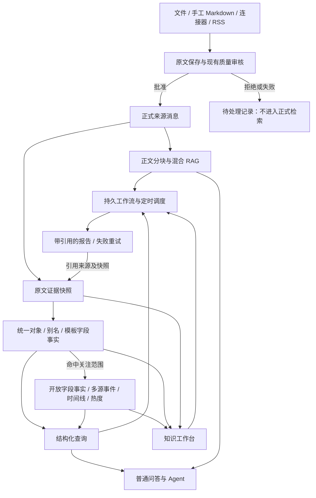

# 知识库融合：发现信息、组织事实、执行研究

2026-10-04 增量已写入 Reliquary 源码，继续使用现有数据库、模型、检索、队列和界面。没有新增外部运行包。以下说明区分工程行为与真实模型质量。

## 本轮吸纳的机制

| 机制 | 当前行为 | 使用入口 |
| --- | --- | --- |
| V7 的预建模知识结构 | 按领域模板定义对象类型、字段、关系与单位族；内置 AI 行业包含上下文长度、本地部署、许可、发布日期、开发者与版本关系。模板可编辑，关注范围内的开放字段保留原名、数值、单位和引文 | 知识工作台 → 结构化查询 |
| 结构优先取材 | 先解析对象/字段，缩小证据范围，再读取正文。聊天先查结构化结果，再用原文检索补充 | 普通问答、Agent 知识上下文查询、工作流事实查询 |
| 按条件比较 | `min_value` / `max_value` / `unit` 支持同类单位的数值条件。例如属性 `context_length`，下限 `128000`，单位 `tokens`。`128 k tokens` 可比较为 `128000 tokens`，存储仍保留原值和单位 | 查询表单与事实查询步骤 |
| AIHOT 的关系判断 | 仅 `same_occurrence` 合并；`same_story` 保留独立事件并关联先前事件；无关事件保持独立。汇总材料在来源层标记，提取事实但不为子事件增加来源数 | 工作台事件与来源证据 |
| AIHOT 的筛选金标评测 | 对人工标注的正式、待审或拒绝材料比较冻结的旧/新筛选规则。开发集和留出集分开；任一结果标签不计指标。不调参、不激活、不改材料状态 | 知识库策略面板 → 筛选评测 |
| 结构化报告输入 | 事实、事件、人工纠正说明和可引用证据同时进入报告；本期、历史背景、日期未知分别标记。恢复运行后仍读取保存的结构化输出 | 工作流报告步骤、研究报告 |
| 原文核验 | 点击事实或报告引用，在侧栏打开固定快照并精确高亮引文；版本和正文哈希可见，主结果仍保留。截断摘录只匹配其准确前缀 | 事实的来源快照、报告的引用 |

来源：AIHOT 的[筛选方法与评测入口](https://github.com/KKKKhazix/AIHOT/blob/main/docs/selection.md)、[事件关系方法](https://github.com/KKKKhazix/AIHOT/blob/main/docs/grouping.md)，核查时 main 指向 [1ca5d6d](https://github.com/KKKKhazix/AIHOT/commit/1ca5d6dd97ca876ade8fba593da9e4f93228918f)。仓库使用 MIT；本轮用 Go/Vue 适配这些方法，没有引入其包或品牌资产。V7 的[知识建模方法](https://www.v7labs.com/blog/enterprise-ai-memory-layer)来自公开资料；公开资料没有提供该服务端源码，因此本轮在 Reliquary 中自行实现，不宣称复制其专有实现。

筛选评测接口为 `POST /api/v1/knowledge-bases/{id}/strategies/{version_id}/evaluate`。每次 1–20 条：`samples: [{knowledge_id, label, split}]`。标签为 `select` / `reject` / `either`，数据集为 `development` / `holdout`。界面展示正确收录、错误收录、遗漏收录、正确拒绝，以及精确率、召回率和逐例理由。留出材料应由用户保留，不用于修改规则；系统不自动选择数据集或保证人工划分独立。评测点击后会调用知识库模型，本轮工程验证使用替身。

查询返回的是已选资料与当前页，不是完整知识覆盖证明。单位未知、不同条件、尚未抽取或冲突的材料需要回到原文核验。没有测量真实资料上的延迟收益，也没有从替身测试推断真实模型的准确率。

Reliquary 现在把原始消息、对象事实、事件和报告任务放在同一个知识库中。知识库详情页新增「知识工作台」，对象、事件、证据、报告和工作流共享同一套后端记录。

## 总体架构



## 三者优势如何结合

| 产品启发 | 落到 Reliquary 的能力 | 使用边界 |
| --- | --- | --- |
| Reliquary 的文档理解、混合检索与 Agent | 继续使用解析、索引、采集和本地存储；新能力接入 Asynq 任务队列 | 原有服务仍是产品底座 |
| AIHOT 的持续发现与多源事件观察 | 同一具体变化的消息聚为事件，展示独立来源、事件时间、热度和关注价值 | 热度不代表真实性；关注价值与入库质量分开 |
| V7 Go 的对象知识与任务执行 | 跨消息统一对象和别名，保存带出处的属性、关系、有效时间，结构化查询与 RAG 合用；知识流程可持续运行 | 这是本项目的实现；没有照搬 V7 的专有平台或宣称复现其全部能力 |

参考：[AIHOT 源码](https://github.com/KKKKhazix/AIHOT)、[V7 Context Graph](https://www.v7labs.com/context-graph)、[V7 官方文档](https://docs.go.v7labs.com/)。用户提供的 V7 Go 产品图用于理解能力范围；其中「图谱变更触发自动工作流」标为规划方向，本次没有将其当成已发布能力。

## 数据与可信度

对象身份在个人空间内共享，每个知识库必须属于一个领域。规范名按“空间 + 对象类型 + 规范化名称”唯一；别名按“空间 + 对象类型 + 规范化别名”唯一，同名的不同类型对象可并存。规范名及别名先做兼容对象类型内的精确匹配。未命中时通过 PostgreSQL `pg_trgm` 召回规范名与别名，并在全局默认向量档位可用时补充名称向量召回；合并排序后最多带入 20 个候选，一次模型判断返回匹配、新建或不确定。不确定时新建独立对象并保存待合并建议，工作台可接受或拒绝，接受复用全局合并。模型家族与具体版本独立，版本号不同不能通过精确命中自动归为同一对象。它不会因为两篇文章标题相近，就把不同公司或不同事件强行合并。

事实是「某来源对某对象的断言」。属性保存 JSON 值、类型、单位和有效时间；关系保存两个对象及关系名。每条事实都带证据 ID 和逐字原文引用，抽取器校验引文存在于来源正文。同属性的不同记载并存，工作台按有效期显示差异或「待核实差异」。人工纠正生成新版本，保留旧事实、纠正说明及操作者。

证据快照保存正文、标题、作者、发布者、原始 URL、发布时间和图片引用。来源更新使用候选版本：审核、解析成功后才替换正式版本，旧来源及其引用保留为历史；候选被拒绝或处理失败时，旧版本仍可用。显式删除来源或知识库会清理该来源的事实、事件证据、关注评分与证据快照，不提供被删除来源的历史访问。仍被其他知识库证据引用的对象和事件保留，没有任何证据引用的对象才删除。

事件候选必须具有关联对象交集，并按事件时间或来源发布时间限定在前后 7 天内；时间均缺失时只按对象交集召回。最多召回 10 个候选，每个抽取事件只判断一次。事件归并还需模型确认是同一具体变化。热度以 48 小时内的来源发布时间计算，按 24 小时半衰期衰减，同一发布者取一次贡献；没有发布时间的来源不因今天导入而变成新热点。这是本项目的确定公式，并不声称与 AIHOT 未公开的细节完全一致。关注价值另存新颖性、影响、可信度、相关性、可行动性及评分理由；模型评分仍需判断和核实。

报告是知识产物，不能作为另一条独立新闻来源增加事件可信度。问答同时读取结构化事实和正文 RAG；没有结构化命中或查询失败时保留现有正文检索路径。Agent 的 `query_knowledge_context` 返回实际对象与关系，并提供证据入口。新上下文存储统一使用 PostgreSQL。

## 配置与升级

1. 使用本仓库源码构建前后端，按 [README](../README.md) 的「从源码启动」步骤启动。新能力没有增加运行时依赖或独立工作流引擎。
2. 使用 `DB_DRIVER=postgres`。2026-10-07 已将 PostgreSQL 旧 `000000` 至 `000098` 迁移压缩为 `000000_init`，知识上下文、工作流、事件关系与纠正记录均包含在基线中。旧数据库不能原地升级，需要重建空库后启动迁移，后端和前端一起升级；具体操作见 [数据库迁移排障](migration-troubleshooting.md#single-baseline-and-database-rebuild)。
3. 在空间设置配置 `light`、`extraction`、`generation`、`embedding`、`rerank` 五个模型档位。领域编辑及知识库模型配置可覆盖单个档位，未配置项按知识库、领域、空间逐级回退；三个层级都为空时兼容原摘要、自动标签及嵌入模型字段。会话或报告的显式模型选择优先。Ollama 与 vLLM 可使用现有 OpenAI 兼容提供商。模型错误在任务状态中可见，不会把失败抽取当作成功知识。
4. 持续采集使用现有 RSS、站点适配器及其同步日程；按网址收录仍经过原来的下载、解析和质量审核。
5. 升级只创建数据结构。历史来源不会自动完成抽取：在「知识工作台」点击「重新构建知识上下文」，或通过重建接口选定来源。返回的是入队数量，完成状态要看后台任务及来源处理状态。

工作流调度在服务启动并注册任务处理器后启动；所有部署使用 Redis 与既有 Asynq 异步队列。任务、步骤、报告和运行租约都持久保存；重启后调度器恢复未完成运行。调度采用五段 cron 和 IANA 时区，空 cron 表示仅手动运行。服务关闭期间不运行任务，恢复时不会补发期间所有日报。

## 工作台使用

1. 导入资料并等待质量审核、正文处理和知识上下文处理完成。
2. 在「对象」中选择单知识库、当前领域或全部知识库范围，按名称或别名查询，可增加属性、关系和时间条件；查看事实引用，打开原文快照，必要时提交纠正或合并对象。历史开关显示被替代的事实和证据。
3. 在「事件」中查看时间线、独立来源及热度；结合关注评分和理由决定后续跟踪。没有事件日期时显示未知或使用来源发布时间，不把采集时间当事件时间。
4. 在「任务」中使用对象跟踪、日报或周报模板，按需设置知识搜索、事实查询和报告步骤。启用后可以手动运行，也可以按配置日程执行。
5. 在运行详情查看步骤状态、输出、错误和来源。运行期间禁用工作流会暂停，重新启用后可恢复。失败运行可重试，已经成功的步骤及报告继续复用。
6. 在「报告」中查看引用与时间范围，下载 Markdown 或 JSON。

登录用户和有效 API Key 均可读取及编辑对象、事件、证据和领域模板。对象详情汇总全部知识库的事实与事件，并显示来源知识库。内置领域可编辑但不可删除，被知识库引用的领域不可删除。工作流和报告沿用现有任务业务规则；限定文档或标签的 Agent 查询只返回选定范围内的来源。

## 工作流示例

以下 JSON 可提交到 `POST /api/v1/knowledge-bases/{kb_id}/workflows`。`enabled` 为真才运行；工作流步骤按声明顺序执行，依赖只能引用更早的步骤。

```json
{
  "name": "行业日报",
  "description": "从已有知识库检索昨日资料，生成有出处的日报",
  "enabled": true,
  "schedule": {"cron": "0 9 * * *", "timezone": "Asia/Shanghai"},
  "steps": [
    {"id": "sources", "type": "search", "config": {"query": "行业进展", "limit": 100}},
    {"id": "report", "type": "report", "depends_on": ["sources"], "config": {
      "title": "行业日报", "window": "previous_day", "timezone": "Asia/Shanghai",
      "prompt": "说明关键变化、来源差异及需要继续核实的问题，并引用来源。"
    }}
  ]
}
```

周报可改为周一运行 `0 9 * * 1`，报告窗口改为 `previous_week`，取所在时区上周一至周日。`rolling_days` 配合 `days`（1–365）生成滚动时间范围；也可指定 `time_from`、`time_to`。时间窗口按**来源发布时间**过滤报告证据，没有发布时间的来源不会进入有日期窗口的报告；空结果会明确失败，不凭空生成摘要。检索有数量上限，日报不是无遗漏的全库统计。

对象跟踪使用 `fact_query` 步骤，例如 `{"entity":"Acme","predicate":"revenue","include_history":true,"limit":50}`；支持 `relation`、`object_entity_id`、`since`、`until`。

事实查询的 `since` / `until` 按**有效期与查询区间相交**筛选，包含相等的边界。事实的有效期或查询区间只给出一端时，另一端视为无界。事实两端都没有日期时，使用来源发布时间作为单个时间点；连发布时间也缺失的事实，只在没有时间条件时返回。例如有效期为 2025–2027 年的事实，可以出现在 2026 年的查询结果中。此规则适用于 `/context/query` 和工作流 `fact_query`；事件仍按事件时间筛选，报告证据仍按上述来源发布时间规则筛选。

默认工作流不会发送外部消息或发布网站。

## API 入口

原知识库路径以 `/api/v1/knowledge-bases/{kb_id}` 开头，继续兼容单知识库查询。新增 `/api/v1/knowledge-context` 空间入口，查询及对象、事件列表用 `scope` 选择 `knowledge_base`、`domain` 或 `all`，分别配合 `knowledge_base_id` 或 `domain_id`。对象详情在空间入口汇总全部来源。

| 方法与路径 | 用途 |
| --- | --- |
| `POST /context/query` | 对象、属性、关系、来源及时间的组合查询 |
| `GET /context/entities`、`GET /context/events` | 分页浏览对象、事件 |
| `GET /context/evidence`、`GET /context/evidence/{id}` | 证据列表及完整快照 |
| `POST /context/facts/{id}/correction` | 保存事实纠正版本 |
| `POST /context/entities/merge` | 人工合并对象 |
| `POST /context/rebuild` | 重建全部或选定正式来源的上下文 |
| `GET/POST /workflows`、`GET/PUT/DELETE /workflows/{id}` | 管理工作流定义 |
| `POST /workflows/{id}/run`、`GET /workflows/{id}/runs` | 手动运行及查看历史 |
| `GET /workflows/runs/{id}` | 查看运行和各步骤 |
| `POST /workflows/runs/{id}/resume`、`POST /workflows/runs/{id}/retry` | 恢复暂停或重试失败运行 |
| `GET /reports`、`GET /reports/{id}` | 报告及固定引用 |
| `GET /reports/{id}/download?format=markdown` | 下载；`format=json` 获取结构化报告 |

新增领域管理接口：

| 方法与路径 | 用途 |
| --- | --- |
| `GET/POST /api/v1/knowledge-domains` | 列出或创建领域 |
| `GET/PUT/DELETE /api/v1/knowledge-domains/{id}` | 读取、编辑或删除领域模板 |
| `GET /api/v1/knowledge-domains/{id}/open-fields` | 统计开放字段次数和示例事实 |
| `POST /api/v1/knowledge-domains/{id}/field-mappings` | 将 `open_field` 追加到 `field_key` 的别名 |
| `POST /api/v1/knowledge-domains/{id}/fields` | 将开放字段新建为模板字段 |
| `POST /api/v1/knowledge-context/query` | 按三种范围查询结构化知识 |
| `GET /api/v1/knowledge-context/focus` | 按三种范围查看星标对象、星标主题、跟踪任务对象与可星标标签 |
| `PUT/DELETE /api/v1/knowledge-context/entities/{entity_id}/star` | 添加或取消对象星标，只影响后续收录 |
| `PUT/DELETE /api/v1/knowledge-context/topics/{tag_id}/star` | 添加或取消具体所指标签星标，内容性质标签不可星标 |
| `GET /api/v1/knowledge-context/entities`、`GET /api/v1/knowledge-context/events` | 按三种范围浏览对象与事件 |
| `GET /api/v1/knowledge-context/entities/{entity_id}` | 汇总对象在全部知识库中的事实和事件，`include_history` 默认为 `true` |
| `GET /api/v1/knowledge-context/evidence`、`GET /api/v1/knowledge-context/evidence/{evidence_id}` | 按范围读取来源证据列表或证据详情 |
| `POST /api/v1/knowledge-context/facts/{fact_id}/correction` | 纠正事实并保存纠正版本 |
| `POST /api/v1/knowledge-context/entities/merge` | 合并空间对象并记录受影响知识库 |
| `PATCH /api/v1/knowledge-context/entities/{entity_id}/description` | 编辑对象描述并将名称向量标记为待重建 |
| `GET /api/v1/knowledge-context/merge-suggestions` | 按范围、状态及分页列出待合并建议 |
| `POST /api/v1/knowledge-context/merge-suggestions/{id}/accept`、`POST /api/v1/knowledge-context/merge-suggestions/{id}/reject` | 接受并合并，或拒绝建议 |
| `GET/PUT /api/v1/space/model-tiers` | 全局默认档位配置；读取支持 `domain_id` 或 `knowledge_base_id`，返回每档位生效模型与来源 |
| `GET/POST /api/v1/knowledge-context/name-embeddings/rebuild` | 查看空间对象名称向量重建状态，或将待重建对象加入后台任务 |

抽取提示词动态列出所属领域的对象类型、字段及别名、值类型、单位族、关系和 `extraction_hints`。数值比较只采用该领域明确配置的单位族；未知单位不推断，缺少单位的数值不视为 tokens。字段归并只改变查询别名匹配，不修改原始事实。工作流 `fact_query` 与 Agent `query_knowledge_context` 同样接受查询范围。

设置区提供领域管理和字段归并视图，知识库创建及编辑提供领域选择。

唯一用户与 API Key 均有完整访问权限。知识库、领域与时间范围继续用于业务筛选；知识上下文、名称向量重建、工作流与报告均需鉴权。登录、API Key 与本地密码恢复见[个人使用说明](personal-use.md)。

## 按关注范围收录结构化数据

每条通过现有审核的正式消息保存不可变证据快照。第一轮使用精简提示词，输出格式只要求对象和领域模板字段或关系事实，不要求开放字段与事件。对象包含提及、规范名、类型、描述、逐字引文及有来源支持的别名；字段 key、label、aliases 及模板关系均视为模板词汇。服务端仍过滤意外返回的开放字段与事件。对象继续按 P3 召回及判断统一身份，证据与识别对象独立关联，即使没有事实或事件也能浏览对象及原文。

对象解析完成后，关注范围按星标对象、星标具体所指标签及启用跟踪任务的对象和主题取并集。具体所指标签包括 topic、object、event，nature 标签不属于关注主题。星标对象在空间内生效，标签按现有知识库标签身份匹配。分类已经给出但异步自动标签尚未保存时，可复用已批准分类的具体标签；人工取消的标签不据此恢复命中。星标与知识库、智能体等资源收藏分别保存，权限沿用工作台现有读取及编辑规则。

关注范围视图的对象星标列表体现其跨知识库行为：普通用户在知识库、领域和全部知识库范围均可看到全部全局对象星标，即使该对象尚未在所选知识库出现。有效 API Key 与登录用户均可看到全部全局对象星标。主题标签及跟踪任务条件继续按所选范围展示。

跟踪对象从启用且未删除工作流的 `fact_query` 步骤推导，对象跟踪模板也通过这类步骤表达条件。`entity_id` 与 `object_entity_id` 使用全局对象身份，`entity` 按现有结构化查询的规范名称及别名子串规则匹配；已合并对象沿合并身份解析。每一步的 knowledge_base、domain、all 范围决定涉及哪些来源知识库，未声明范围时沿用工作流知识库。当前工作流没有结构化主题条件，跟踪主题集合为空；自由搜索文字、报告提示及研究问题不推断为具体标签。

命中时按原分段计划追加补缺抽取，第二轮只要求开放字段事实与事件，不重复输出对象或模板事实。第一轮对象及模板事实直接复用，服务端过滤第二轮意外返回的对象和模板事实；开放字段与事件端点须引用第一轮已验证的对象提及，每条引文仍须来自当前分段。第二轮不回传第一轮输出作为模型输入，直接从同一原文读取对象提及，避免增加窗口占用。最终保存第一轮对象和模板事实、第二轮开放事实与事件，逐字引文、日期、事件聚合及汇总材料规则保持原语义。未命中时只保留模板字段事实，不产生事件。添加星标不重抽历史消息，取消星标不删除已有事实或事件。事件时间线与热度因此只覆盖收录时命中范围的消息，不能当作全库完整变化统计。issue 02 的模板覆盖约 1% 至 3%，范围外消息可能几乎没有事实。

证据 `extraction_mode` 为 `template_only` 或 `full`，描述结构范围；`extraction_status` 描述成功或失败；`extraction_coverage`、`processed_segments`、`total_segments` 描述所选模式的分段处理覆盖。完整抽取失败仍标记 full，但状态为 failed 且分段覆盖单独呈现，不能显示为完成。模式不表示字段级覆盖，也不保证模型识别完备。

结构化查询返回 `template_only_message_count`，工作台提示“另有 N 条相关消息仅抽取了模板字段”。计数在分页前对所选知识库、领域或全部知识库范围筛选，仅统计可见、已完成 template_only 抽取的消息，按 knowledge_id 去重；默认只算当前证据，包含历史时多个版本仍只算一条消息。指定对象名称或身份时按独立证据对象关联判断，关系客体条件进一步要求关联该对象；事件条件使用所选事件的对象。没有对象条件时统计范围内有对象关联的消息。时间条件以来源发布时间过滤，缺日期的不计入带时间范围的计数。尚未抽取的字段与值无法证明是否符合查询，因此字段、数值条件不减少此覆盖提示。失败、禁用、待审及已删除来源不计数。本次不提供补抽入口；需要对范围外历史材料做结构化分析时再评估完整方案，见 ADR 0006。

## 调用预算与处理并发

每条消息一次处理尝试的应用层模型调用预算只与消息长度、未精确命中的提及数及抽取事件数有关，与对象总数和知识库规模无关。精确名称及别名命中不调用判断模型；候选为空的未命中提及和事件仍分别只判断一次。失败重试会产生新的调用，后台名称向量重建单独统计调用，不能用这份单次消息预算推算历史重建总量。

| 阶段 | 档位 | 每条消息的调用次数 |
| --- | --- | --- |
| 筛选与双轴标签 | `light` | 一次结构化输出同时给出审核和标签；已缓存分类结果的自动标签步骤复用结果 |
| 对象识别与模板字段事实 | `extraction` | 精简提示词，实际尝试抽取的段数 S，范围内外都执行 |
| 开放字段事实与事件补缺 | `extraction` | 仅命中关注范围时追加 S 次，复用原分段计划，不重复对象或模板事实 |
| 对象判断 | `light` | 未精确命中的提及数，每次最多 20 个候选 |
| 事件判断 | `light` | 仅完整模式的抽取事件数 E，每次最多 10 个候选 |
| 关注评分 | `light` | 默认一次，可关闭 |
| 对象名称向量 | `embedding` | 全局默认向量模型可用时，每个未命中提及通常一次；新建前纠正规范名时再生成一次，精确命中跳过 |

`RELIQUARY_CONTEXT_ENTITY_TOP_K`、`RELIQUARY_CONTEXT_EVENT_TOP_K` 可修改召回上限；`RELIQUARY_CONTEXT_MAX_SEGMENTS` 可修改抽取段数上限；`RELIQUARY_CONTEXT_ATTENTION_ENABLED=false` 关闭关注评分。名称向量不可用或档位不一致时继续使用名称召回。

证据详情的 `model_calls` 按阶段、档位、模型记录实际调用次数，包含失败尝试；审核元数据及处理阶段同样保存筛选标签调用统计。长文覆盖信息单独显示，部分抽取不会被显示成完整覆盖。替身测试只验证预算及工程行为，不衡量真实模型质量。

令 U 为非精确对象提及判断次数，A 为可选关注价值评分次数（通常 0 或 1），B 为名称向量调用次数。改动前结构化处理为 S + U + E + A + B；范围外为 S + U + A + B，不增加调用；范围内为 2S + U + E + A + B。对象只在第一轮识别和解析，补缺轮不增加 U、B。筛选标签调用与正文向量、摘要等既有收录调用在这些公式之外，分别记录。两轮分段都按原完整提示词规划窗口，实际第一轮发送精简提示词，第二轮发送补缺提示词，逐段复用相同正文和输出上限。`context_extraction` 记录第一轮，保留阶段名 `context_full_extraction` 记录第二轮补缺，实际每消息预算以证据记录为准。

调用次数与 token 成本分别评估。范围外不请求开放字段或事件，提示词和预期输出均缩小。范围内两轮合计只输出一次对象、模板事实、开放事实和事件，不再两次输出完整结构；输入仍包含两次正文及请求开销，不能保证总 token 成本低于原单轮完整抽取。成本对比应同时记录每轮提示词、含正文的请求规模与预期输出项，替身估算不代表真实模型账单或抽取质量。

并发与速率按模型及档位分别控制，抽取等待不会占用轻量判断的并发预算。普通写入使用空间共享维护屏障，同一规范名及别名才竞争身份哈希锁；证据与已有事件使用行锁。对象合并、删除和引用清理取得空间独占维护屏障，避免其引用快照与普通写入交错。所有模型与向量调用均在这些写库锁之外，数据库唯一约束及写入前重新解析当前身份共同防止重复对象及孤儿引用。

### 候选召回的数据库成本

规范名与别名分别使用 GIN trigram 索引 `idx_kce_name_trgm`、`idx_kcea_alias_trgm`。名称向量列使用 pgvector，`idx_kce_embedding_profile` 是筛选空间、模型和维度的普通索引，没有为对象名称向量建立 ANN 索引。向量查询先通过 `WITH compatible AS MATERIALIZED` 固化兼容对象类型、同模型、同维度且无需重建的集合，再计算余弦距离，避免对不同维度向量求距离。

当前每个未精确命中的提及都会计算这批兼容对象的向量距离，并选出 top-K。数据库距离计算成本随同档位兼容对象数量线性增长；top-K 限制的是传给判断模型的候选数。因此模型调用规模无关不代表数据库耗时也与规模无关，正文 RAG 的向量索引也不会自动覆盖对象名称向量表。

当同模型、同兼容类型的对象达到几万条，或实际召回耗时超过目标延迟时，可考虑按模型及维度分区并建立 HNSW 索引，同时验证类型过滤后的召回质量。这是后续工程优化建议，几万条不是本轮测试得出的性能阈值；本轮规模测试验证调用次数，不宣称数据库查询已有恒定耗时。

### 对象名称向量重建

空间内全局对象统一使用空间 `embedding` 档位的名称向量 profile，包含模型 ID、维度及模型语义参数的指纹。指纹包含模型名、来源、类型、状态、服务地址、接口类型、提供商、嵌入参数及额外配置；认证凭据、并发额度和显示名修改不会触发全量重建。领域或知识库的 `embedding` 覆盖仍用于各自正文检索，不改变全局对象的名称向量 profile；空间未配置可用向量模型时只使用名称召回。对象保存名称向量、模型 ID、实际维度和 `embedding_needs_rebuild` 标记，旧档位、缺失或语义参数已变的向量不会参与当前向量召回。

启动检查、空间及领域或知识库的模型配置修改、工作台知识上下文重建、手动触发，以及对象描述修改和合并都会检查或加入名称向量重建任务。日常对象解析只读取匹配当前 profile 的向量，不在每条消息处理时扫描全表更新重建标记。重建任务按空间固定 profile 为待处理对象生成“名称 + 类型 + 描述”的向量，默认每批 64 个对象，可通过 `RELIQUARY_CONTEXT_EMBEDDING_BATCH_SIZE` 配置，最多每批 500 个。后台模型调用按 `embedding` 档位限流；调用次数取决于待重建对象数量，独立于单条消息预算。`idx_kce_embedding_pending` 为待重建对象列表提供部分索引。

通过 `GET /api/v1/knowledge-context/name-embeddings/rebuild` 查看持久状态。响应的 `pending_count` 表示当前待重建对象数，有历史任务时 `latest_run` 提供 `pending`、`running`、`completed` 或 `failed` 状态、触发原因、模型 ID、维度、已处理数、总数、模型调用数、尝试次数、起止时间和错误；`POST` 返回入队后的状态，不能把接口成功当成重建完成。没有待重建对象时不创建空任务。工作台重建即使没有待抽取消息，也会检查名称向量任务；名称向量任务的进度和失败通过上述接口查看。

名称向量生成和重建模型调用在写库锁外执行。新对象写入及重建写回采用短事务，以空间及模型配置行的共享锁检查当前 profile；重建同时校验对象名称、类型、描述及更新时间。对象已合并或删除时不写回，调用期间对象或档位变化时丢弃旧结果或将对象保留为待重建状态。任务完成后仍可能存在后来新增或发生变化的待重建对象，应同时查看 `pending_count`。

## 验证与限制

### 信源、转载与发布时间

RSS 的站点差异由域名和路径适配器注册表管理，新增步骤见 `internal/datasource/connector/rss/ADAPTERS.md`。恢复失败会写入 `source_adapter_failed` 异常，保留站点、URL、适配器和原因，并回退到通用正文抓取。回归测试只读取保存的 HTML 或 API 样本。

同一知识库内按规范化 URL、正文 SHA-256、64 位 SimHash 三层检测重复。近似检测默认最大距离为 3，可用 `RELIQUARY_DUPLICATE_SIMHASH_DISTANCE` 设置为 0 至 16；少于 100 字符的正文不做近似检测，候选长度为正文的 0.8 至 1.25 倍。重复消息不重复抽取，来源 URL、发布者、作者和发布时间写入已有消息的 `knowledge_repost_sources`。消息、证据和事件详情返回 `repost_sources`，工作台可查看列表。事件沿用发布时间窗口和发布者唯一规则，同一发布者的多个转载只计一次。跨知识库的正文仍各自收录，以保留领域和证据范围。

缺少或无法解析发布时间的证据及转载标记 `published_at_missing`，采集时间不补作发布时间。结构化查询、证据列表和事件接口返回 `excluded_missing_published_at_count`；统计在分页前按消息及转载记录去重，代表当前可见相关来源中不能参与发布时间筛选或热度计算的数量。事实适用时间和事件发生时间的既有规则保留。

报告材料、工作流报告步骤、持久报告和 JSON 下载包含同名排除数字，报告正文及工作台显示该数字。带时间范围的报告排除发布时间未知的来源，多步骤重复来源只计一次；无时间范围的报告继续允许日期未知材料。全部候选缺日期时保存材料缺失说明和排除数，不调用生成模型。Markdown 引文校验与高亮采用相同格式规范化，去除强调和行内代码标记、保留链接文字、归一表格分隔与空白后做连续逐字匹配，再映射至原文位置；保存的事实引文保持模型原样。

可重复的融合验证入口：

```bash
go test ./internal/router -run '^TestKnowledgeFusionPersistsContextWorkflowReportAndEvidence$' -count=1
go test ./internal/application/service ./internal/application/service/chat_pipeline ./internal/agent/tools ./internal/handler ./internal/router ./internal/container ./internal/database ./internal/application/repository ./internal/types
cd frontend
npm run type-check
npm run check-i18n
npm run build-only
```

API 融合测试保留来源记录、上下文 Worker、Agent 知识上下文查询、持久工作流和报告，并验证 Markdown/JSON 下载、来源快照和空间边界校验。工作流服务测试验证定义快照、禁用后恢复、失败重试、成功步骤与报告不重复、运行租约及撤权；每日与每周模板均可运行完成。模型替身只证明工程行为，不证明真实模型消歧、事实抽取或报告质量。

结构化抽取取消 800,000 字节上限。抽取器读取模型当前配置的上下文长度，未配置时按 8,192 tokens 规划；预留提示词、安全余量和输出空间，输出最多 2,048 tokens，并受模型输出上限约束。长文使用现有章节分块器切分，章节超窗口时继续按段落或句子切分；受保护的大块内容仍执行最终窗口检查。各段引文只能来自该段，跨段事实按主体、谓词、值及引文去重，合并提及后统一解析对象。默认最多处理前 32 段，超过时证据记录 `extraction_coverage=partial`、已处理段数及总段数，工作台显示“部分抽取”。完整原文快照保留，文件读取仍受 32 MiB 的证据读取安全上限约束。事件匹配和关注评分会产生模型调用；历史重建会消耗模型额度。界面差异提示比较已加载记录的实际值、单位与有效期，不能自动判断不同表达是否语义等价。报告校验引用编号和证据存在，不自动证明每一句推理都正确，应结合人工审核使用。

运行租约与报告唯一约束防止重复运行覆盖结果，成功步骤在重试时跳过。实际摘要模型需要在配置好凭据的实例中验收。
