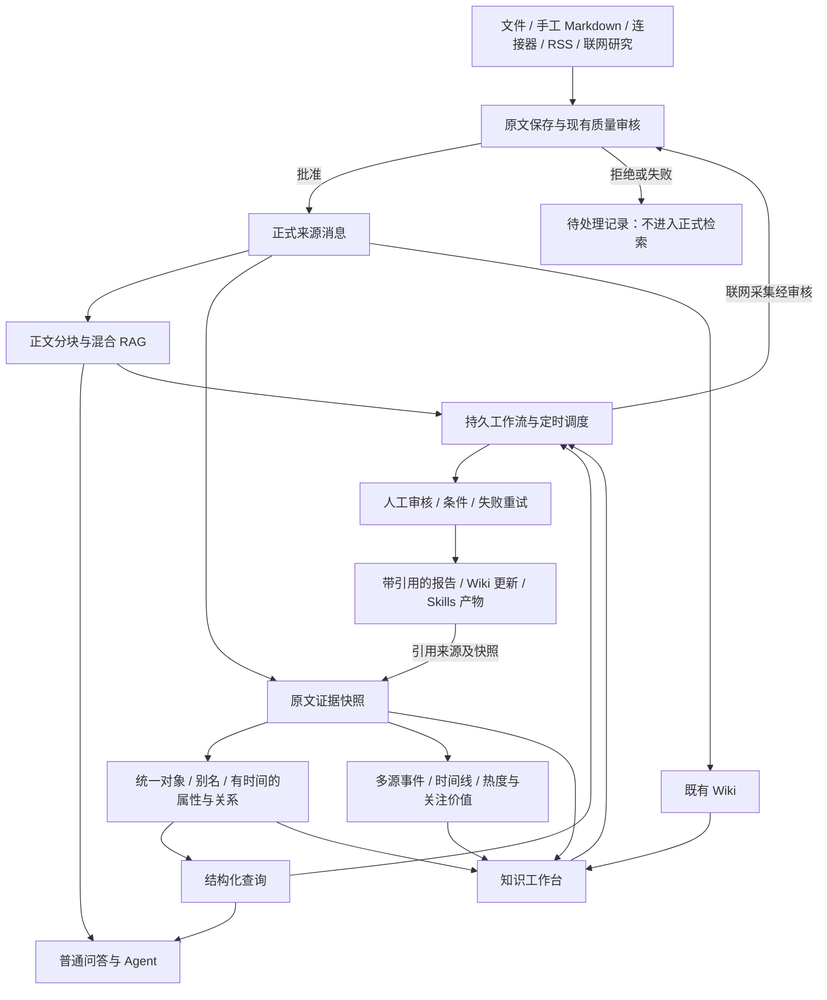

# 知识库融合：发现信息、组织事实、执行研究

2026-10-04 增量已写入 Reliquary 源码，继续使用现有数据库、模型、检索、队列和界面。没有新增外部运行包。以下说明区分工程行为与真实模型质量。

## 本轮吸纳的机制

| 机制 | 当前行为 | 使用入口 |
| --- | --- | --- |
| V7 的预建模知识结构 | 统一上下文长度、本地部署、许可、发布日期、开发者与版本关系；保存原字段名、数值、单位和引文。未知字段继续保留 | 知识工作台 → 结构化查询 |
| 结构优先取材 | 先解析对象/字段，缩小证据范围，再读取正文。聊天先查结构化结果，再用原文检索补充 | 普通问答、Agent 图查询、工作流事实查询 |
| 按条件比较 | `min_value` / `max_value` / `unit` 支持同类单位的数值条件。例如属性 `context_length`，下限 `128000`，单位 `tokens`。`128 k tokens` 可比较为 `128000 tokens`，存储仍保留原值和单位 | 查询表单与事实查询步骤 |
| AIHOT 的关系判断 | 仅 `same_occurrence` 合并；`same_story` 保留独立事件并关联先前事件；无关事件保持独立。汇总材料在来源层标记，提取事实但不为子事件增加来源数 | 工作台事件与来源证据 |
| AIHOT 的筛选金标评测 | 对人工标注的正式、待审或拒绝材料比较冻结的旧/新筛选规则。开发集和留出集分开；任一结果标签不计指标。不调参、不激活、不改材料状态 | 知识库策略面板 → 筛选评测 |
| 结构化报告输入 | 事实、事件、人工纠正说明和可引用证据同时进入报告；本期、历史背景、日期未知分别标记。恢复运行后仍读取保存的结构化输出 | 工作流报告步骤、研究报告 |
| 原文核验 | 点击事实或报告引用，在侧栏打开固定快照并精确高亮引文；版本和正文哈希可见，主结果仍保留。截断摘录只匹配其准确前缀 | 事实的来源快照、报告的引用 |

来源：AIHOT 的[筛选方法与评测入口](https://github.com/KKKKhazix/AIHOT/blob/main/docs/selection.md)、[事件关系方法](https://github.com/KKKKhazix/AIHOT/blob/main/docs/grouping.md)，核查时 main 指向 [1ca5d6d](https://github.com/KKKKhazix/AIHOT/commit/1ca5d6dd97ca876ade8fba593da9e4f93228918f)。仓库使用 MIT；本轮用 Go/Vue 适配这些方法，没有引入其包或品牌资产。V7 的[知识建模方法](https://www.v7labs.com/blog/enterprise-ai-memory-layer)来自公开资料；公开资料没有提供该服务端源码，因此本轮在 Reliquary 中自行实现，不宣称复制其专有实现。

筛选评测接口为 `POST /api/v1/knowledge-bases/{id}/strategies/{version_id}/evaluate`。每次 1–20 条：`samples: [{knowledge_id, label, split}]`。标签为 `select` / `reject` / `either`，数据集为 `development` / `holdout`。界面展示正确收录、错误收录、遗漏收录、正确拒绝，以及精确率、召回率和逐例理由。留出材料应由用户保留，不用于修改规则；系统不自动选择数据集或保证人工划分独立。评测点击后会调用知识库模型，本轮工程验证使用替身。

查询返回的是已选资料与当前页，不是完整知识覆盖证明。单位未知、不同条件、尚未抽取或冲突的材料需要回到原文核验。没有测量真实资料上的延迟收益，也没有从替身测试推断真实模型的准确率。

Reliquary 现在把原始消息、对象事实、事件、Wiki 和研究任务放在同一个知识库中。知识库详情页新增「知识工作台」，对象、事件、证据、报告和工作流共享同一套后端记录。

## 总体架构



## 三者优势如何结合

| 产品启发 | 落到 Reliquary 的能力 | 使用边界 |
| --- | --- | --- |
| Reliquary 的文档理解、混合检索、Agent、Wiki、Skills 与权限 | 继续使用现有解析、索引、采集、沙箱、存储和 RBAC；新能力接入现有 Asynq 任务队列 | 原有服务仍是产品底座 |
| AIHOT 的持续发现与多源事件观察 | 同一具体变化的消息聚为事件，展示独立来源、事件时间、热度和关注价值 | 热度不代表真实性；关注价值与入库质量分开 |
| V7 Go 的对象知识与任务执行 | 跨消息统一对象和别名，保存带出处的属性、关系、有效时间，结构化查询与 RAG 合用；研究流程可持续运行及人工审核 | 这是本项目的实现；没有照搬 V7 的专有平台或宣称复现其全部能力 |

参考：[AIHOT 源码](https://github.com/KKKKhazix/AIHOT)、[V7 Context Graph](https://www.v7labs.com/context-graph)、[V7 官方文档](https://docs.go.v7labs.com/)。用户提供的 V7 Go 产品图用于理解能力范围；其中「图谱变更触发自动工作流」标为规划方向，本次没有将其当成已发布能力。

## 数据与可信度

对象身份在知识库内共享。规范名及别名先做精确匹配，未命中再由模型判断候选，匹配置信度不足时保留不同对象；工作台允许人工合并。它不会因为两篇文章标题相近，就把不同公司或不同事件强行合并。

事实是「某来源对某对象的断言」。属性保存 JSON 值、类型、单位和有效时间；关系保存两个对象及关系名。每条事实都带证据 ID 和逐字原文引用，抽取器校验引文存在于来源正文。同属性的不同记载并存，工作台按有效期显示差异或「待核实差异」。人工纠正生成新版本，保留旧事实、纠正说明及操作者。

证据快照保存正文、标题、作者、发布者、原始 URL、发布时间和图片引用。来源更新使用候选版本：审核、解析成功后才替换正式版本，旧来源及其引用保留为历史；候选被拒绝或处理失败时，旧版本仍可用。显式删除来源或知识库会清理对应派生记录，不提供删除后的历史访问。

事件归并还需模型确认是同一具体变化。热度以 48 小时内的来源发布时间计算，按 24 小时半衰期衰减，同一发布者取一次贡献；没有发布时间的来源不因今天导入而变成新热点。这是本项目的确定公式，并不声称与 AIHOT 未公开的细节完全一致。关注价值另存新颖性、影响、可信度、相关性、可行动性及评分理由；模型评分仍需判断和核实。

Wiki 与报告是知识产物，不能作为另一条独立新闻来源增加事件可信度。问答同时读取结构化事实和正文 RAG；没有结构化命中或查询失败时保留现有正文检索路径。Agent 的 `query_knowledge_graph` 返回实际对象与关系，并提供证据入口。新上下文存储统一使用 PostgreSQL。

## 配置与升级

1. 使用本仓库源码构建前后端，按 [README](../README.md) 的「从源码启动」步骤启动。新能力没有增加运行时依赖或独立工作流引擎。
2. 使用 `DB_DRIVER=postgres`。2026-10-07 已将 PostgreSQL 旧 `000000` 至 `000098` 迁移压缩为 `000000_init`，知识上下文、工作流、事件关系与纠正记录均包含在基线中。旧数据库不能原地升级，需要重建空库后启动迁移，后端和前端一起升级；具体操作见 [数据库迁移排障](migration-troubleshooting.md#single-baseline-and-database-rebuild)。
3. 为知识库配置可用的摘要模型。质量审核、知识抽取、消歧和报告使用知识库模型；正文向量检索继续使用原来的嵌入模型配置。模型错误在任务状态中可见，不会把失败抽取当作成功知识。
4. 持续采集使用现有数据源及其同步日程。联网研究步骤需要配置现有 Web Search 提供商，所得 URL 仍经过原来的下载、解析和质量审核。
5. Wiki 更新需要知识库已有 Wiki 能力。Skills 步骤需要选择有已启用 Skills 的 Agent，并在该租户的沙箱中安装就绪的 Skill。执行复用原来的权限、凭据、沙箱绑定及文件下载接口。
6. 升级只创建数据结构。历史来源不会自动完成抽取：在「知识工作台」点击「重新构建知识上下文」，或通过重建接口选定来源。返回的是入队数量，完成状态要看后台任务及来源处理状态。

工作流调度在服务启动并注册任务处理器后启动；所有部署使用 Redis 与既有 Asynq 异步队列。任务、步骤、报告、等待采集时间和运行租约都持久保存；重启后调度器恢复未完成运行。调度采用五段 cron 和 IANA 时区，空 cron 表示仅手动运行。服务关闭期间不运行任务，恢复时不会补发期间所有日报。

## 工作台使用

1. 导入资料并等待质量审核、正文处理和知识上下文处理完成。
2. 在「对象」中按名称或别名查询，可增加属性、关系和时间条件；查看事实引用，打开原文快照，必要时提交纠正或合并对象。历史开关显示被替代的事实和证据。
3. 在「事件」中查看时间线、独立来源及热度；结合关注评分和理由决定后续跟踪。没有事件日期时显示未知或使用来源发布时间，不把采集时间当事件时间。
4. 在「任务」中使用对象跟踪、日报、周报或持续研究模板，按需设置检索、联网研究、报告、Wiki、Skills、条件及人工审核步骤。启用后可以手动运行，也可以按配置日程执行。
5. 在运行详情查看步骤状态、输出、错误和来源。联网采集尚未完成时显示 `waiting_ingestion`，延后继续；人工审核显示暂停，批准后继续，拒绝后终止。失败运行可重试，已经成功的步骤及报告继续复用。
6. 在「报告」中查看引用与时间范围，下载 Markdown 或 JSON。复杂 Word、PPT、表格或 PDF 使用已有 Skills；产物通过所属会话的受保护下载接口访问。

对象、事件和证据读取沿用知识库读权限；纠正、合并、重建沿用知识库写权限及拥有者/管理员限制。工作流和报告要求知识库拥有者或管理员；运行前、每个步骤及外部写入前重新检查任务拥有者当前权限。共享知识库及限定文档/标签的 Agent 查询只返回允许的来源投影。

## 工作流示例

以下 JSON 可提交到 `POST /api/v1/knowledge-bases/{kb_id}/workflows`。`enabled` 为真才运行；工作流步骤按声明顺序执行，依赖与条件只能引用更早的步骤。

```json
{
  "name": "行业日报",
  "description": "从已有知识库检索昨日资料，生成有出处的日报并人工审核",
  "enabled": true,
  "schedule": {"cron": "0 9 * * *", "timezone": "Asia/Shanghai"},
  "steps": [
    {"id": "sources", "type": "search", "config": {"query": "行业进展", "limit": 100}},
    {"id": "report", "type": "report", "depends_on": ["sources"], "config": {
      "title": "行业日报", "window": "previous_day", "timezone": "Asia/Shanghai",
      "prompt": "说明关键变化、来源差异及需要继续核实的问题，并引用来源。"
    }},
    {"id": "review", "type": "human_review", "depends_on": ["report"], "config": {}}
  ]
}
```

周报可改为周一运行 `0 9 * * 1`，报告窗口改为 `previous_week`，取所在时区上周一至周日。`rolling_days` 配合 `days`（1–365）生成滚动时间范围；也可指定 `time_from`、`time_to`。时间窗口按**来源发布时间**过滤报告证据，没有发布时间的来源不会进入有日期窗口的报告；空结果会明确失败，不凭空生成摘要。检索有数量上限，日报不是无遗漏的全库统计。

对象跟踪使用 `fact_query` 步骤，例如 `{"entity":"Acme","predicate":"revenue","include_history":true,"limit":50}`；支持 `relation`、`object_entity_id`、`since`、`until`。持续研究使用 `web_research`，配置 `query`、`provider_id`、`max_results`，来源必须入库审核；后续报告只使用已批准的来源。`wiki_update` 指定 `slug`、`title`、`source_step`，复用前面报告的内容和引用；把人工审核安排在 Wiki 更新或 Skill 步骤前即可控制这些动作。

事实查询的 `since` / `until` 按**有效期与查询区间相交**筛选，包含相等的边界。事实的有效期或查询区间只给出一端时，另一端视为无界。事实两端都没有日期时，使用来源发布时间作为单个时间点；连发布时间也缺失的事实，只在没有时间条件时返回。例如有效期为 2025–2027 年的事实，可以出现在 2026 年的查询结果中。此规则适用于 `/context/query` 和工作流 `fact_query`；事件仍按事件时间筛选，报告证据仍按上述来源发布时间规则筛选。

Skills 配置 `agent_id`、`skill_name`、`script_path`，可给 `args`、`input` 或 `input_step`。条件步骤使用 `step_id`、`path`、`operator`、`value`，后续步骤用 `when: {"step_id":"条件步骤ID","equals":true}` 分支。默认工作流不会发送外部消息或发布网站。

## API 入口

所有路径以 `/api/v1/knowledge-bases/{kb_id}` 开头。

| 方法与路径 | 用途 |
| --- | --- |
| `POST /context/query` | 对象、属性、关系、来源及时间的组合查询 |
| `GET /context/entities`、`GET /context/events` | 分页浏览对象、事件 |
| `GET /context/evidence`、`GET /context/evidence/{id}` | 证据列表及完整快照 |
| `POST /context/facts/{id}/correction` | 保存事实纠正版本 |
| `POST /context/entities/merge` | 人工合并对象 |
| `POST /context/rebuild` | 重建全部或选定正式来源的上下文 |
| `GET/POST /workflows`、`GET/PUT/DELETE /workflows/{id}` | 管理工作流定义 |
| `POST /workflows/{id}/run`、`GET /workflows/{id}/runs` | 手动运行及查看历史 |
| `GET /workflows/runs/{id}` | 查看运行和各步骤 |
| `POST /workflows/runs/{id}/decision` | `approve` 或 `reject` 人工审核 |
| `POST /workflows/runs/{id}/resume`、`POST /workflows/runs/{id}/retry` | 恢复暂停或重试失败运行 |
| `GET /reports`、`GET /reports/{id}` | 报告及固定引用 |
| `GET /reports/{id}/download?format=markdown` | 下载；`format=json` 获取结构化报告 |

上下文读接口允许具有对应范围的 retrieve/full API Key；纠正与重建需 ingest/full 权限。工作流与报告使用 full API Key 并保留用户和知识库授权。

## 验证与限制

可重复的融合验证入口：

```bash
go test ./internal/router -run '^TestKnowledgeFusionPersistsGraphWorkflowReportAndEvidence$' -count=1
go test ./internal/application/service ./internal/application/service/chat_pipeline ./internal/agent/tools ./internal/handler ./internal/router ./internal/container ./internal/database ./internal/application/repository ./internal/types
cd frontend
npm run type-check
npm run check-i18n
npm run build-only
```

API 融合测试保留来源记录、上下文 Worker、Agent 图查询、持久工作流、报告及人工审核，并验证 Markdown/JSON 下载、来源快照和跨租户拒绝。工作流服务测试还验证等待入库、Wiki/Skill 步骤调用、失败重试及撤权；其中 Wiki 与 Skill 使用接口替身。模型替身只证明工程行为，不证明真实模型消歧、事实抽取或研究质量。历史轮次曾在独立 PostgreSQL 16 容器中验证知识上下文与工作流建表、JSONB 数据、唯一约束及回滚，并使用实际知识上下文服务验证抽取、查询、纠正、历史快照、租户隔离和删除清理。相关结构现已纳入 `000000_init`；历史验证不代表当前基线已经用于正式数据库。

结构化抽取及证据快照目前限制为 800,000 字节，超限明确报错，不静默截断，原文和正文 RAG 保留。事件匹配和关注评分会产生模型调用；历史重建会消耗模型额度。界面差异提示比较已加载记录的实际值、单位与有效期，不能自动判断不同表达是否语义等价。报告校验引用编号和证据存在，不自动证明每一句推理都正确，应结合人工审核使用。

运行租约与报告唯一约束防止重复运行覆盖结果，成功步骤在重试时跳过。Skills 复用已保存结果，但外部脚本在副作用完成后、结果保存前进程崩溃，仍可能重跑；有外部写入的 Skill 本身应接受幂等键或安排人工审核。真实联网提供商、实际摘要模型及实际沙箱产物需要在配置好凭据的实例中验收。
